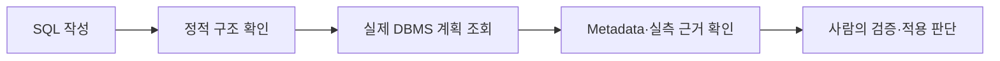
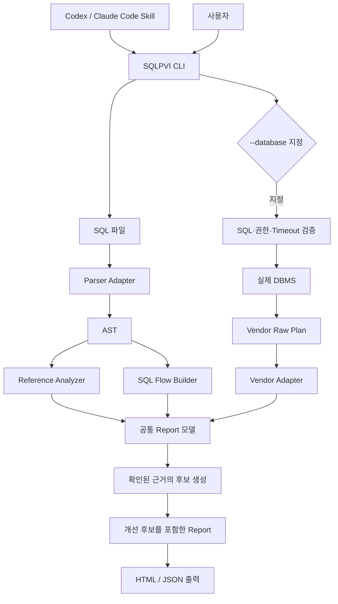
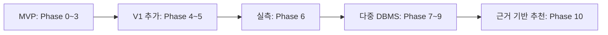

# SQL Plan Visualizer 기획서

SQL Source·AST·SQL Flow·실제 DBMS 실행 계획의 관계를 시각화하는 프로젝트 계약.

세부 구현 기준: `docs/instructions/phaseN-*.md`.
실제 구현·검증 결과: `docs/phaseN-*.md`.
현재 기능·상태: [README](../README.md).

## 1. 프로젝트 배경

SQL 코드만으로 확정하기 어려운 DBMS 실행 방식.
주요 영향 요인: Schema·통계·데이터 분포·Index·권한·DBMS 설정·실행 환경.

| 문제 | 대응 기준 |
| --- | --- |
| 불명확한 Table·Column 참조 | 추측 연결 금지, AMBIGUOUS·UNRESOLVED 유지 |
| 코드만으로 불명확한 실행 방식 | 실제 DBMS Estimated Plan 조회 |
| 통계·분포·Index 영향 | Metadata와 실행 계획의 근거 확인 |
| 실제 Runtime 차이 | 명시적 Runtime 모드의 Actual 측정 |
| DB 직접 연결 위험 | 최소 권한·조회 전용 경계·Timeout·Credential 보호 |

업무 규칙 기반 Schema 설계, ORM N+1 탐지, 데이터 생성 자체의 핵심 범위 제외.

## 2. 프로젝트 개요

SQLPVI의 역할: SQL 파일의 Parsing·AST·Reference·SQL Flow 분석과 Standalone HTML 출력.
DB 모드의 역할: 실제 실행 계획과 정적 분석의 근거 연결.
최종 적용 판단: 사용자 담당. 자동 SQL 최적화·DB 변경 기능의 범위 제외.

| 항목 | 계약 |
| --- | --- |
| 프로젝트 | SQL Plan Visualizer |
| Repository 이름 | `sql-plan-visualizer` |
| Python Package / CLI | `sqlpvi` |
| Skill 이름 / 식별자 | SQLPVI / `sqlpvi` |
| 초기 DBMS | PostgreSQL |
| 개발 환경 | Python 3.13.15, uv, Codex |
| 기본 결과 | Standalone HTML |
| Agent 경로 | Codex·Claude Code의 프로젝트 로컬 Skill |

GitHub 소개 문구: Visualize SQL parsing, ASTs, query flows, and database execution plans.

## 3. 핵심 원칙

### 출처와 참조 상태의 분리

| 구분 | 값 | 의미 |
| --- | --- | --- |
| 출처 | STATIC | SQL Source·Parser에서 확인한 정보 |
| 출처 | DATABASE | DBMS에서 수집한 정보 |
| 출처 | RECOMMENDATION | 확인된 근거에서 도출한 개선 후보 |
| 참조 상태 | RESOLVED | 현재 근거로 연결 대상 확정 |
| 참조 상태 | AMBIGUOUS | 복수 후보에 따른 대상 미확정 |
| 참조 상태 | UNRESOLVED | 대상 확인 근거 부족 |

`RESOLVED BY DATABASE`: 별도 상태가 아닌 UI 표시.
구성: Status=`RESOLVED`, Basis=`DATABASE`.

### Parsing과 실행 가능성의 분리

Parsing 성공 표시: `PARSED`까지만 허용.
`VALID SQL`·`VALID POSTGRESQL QUERY` 등 실제 실행 보증 표현 금지.

### Agent와 분석 엔진의 분리

Agent → SQLPVI CLI → SQLPVI Core의 호출 구조.
분석 결과의 Source of Truth: SQLPVI Core.
DBMS Optimizer의 재구현·흉내 금지.

### 자동 변경 금지

| 허용 | 금지 |
| --- | --- |
| SQL 분석·실행 계획 조회·개선 후보 표시 | 입력 SQL 자동 수정·덮어쓰기 |
| Suggested SQL·Index의 텍스트 표시 | 추천 Query·CREATE/DROP INDEX 자동 실행 |
| 사용자 선택에 따른 검증 | Schema 자동 변경 |

## 4. 분석 모델

| 모델 | 기준 |
| --- | --- |
| SQL Flow | SQL 구조의 표현, `Logical Plan` 명칭 사용 금지 |
| SqlFlow / SqlFlowNode | Scan·Project·Filter·Join·Aggregate·Sort·Distinct·Limit·Offset·CTE·Subquery 표현 |
| Column Reference | 확정 근거 부족 시 AMBIGUOUS·UNRESOLVED 유지 |
| Source Mapping | 실제 SQLGlot의 line·col·start·end Metadata 검증 |

모든 AST 노드의 완전한 Source Range 보장 금지.
Expression 범위 확보 불가 시 Clause·Reference 단위로 축소.
확인되지 않은 Offset의 임의 계산 금지.

## 5. 아키텍처 계약

기본 동작: 정적 분석.
DB 추가 조건: 사용자의 `--database` 지정.
실제 Query 측정 조건: PostgreSQL의 `--database --runtime` 지정.

Renderer 입력: Report 모델 하나로 고정.
Vendor Raw Plan 해석: Adapter 담당.
공통 실행 계획 표시: `Report.plan` 경유.
Renderer의 SQLGlot Expression·Vendor JSON/XML 직접 해석 금지.

## 6. HTML Visualization

| 표시 조건 | 화면 |
| --- | --- |
| 기본 | Overview·SQL Source·References·AST·SQL Flow |
| DB 계획 확보 | Execution Plan |
| PostgreSQL Catalog 확보 | Database Metadata |
| 근거 기반 후보 확보 | Recommendations |

상호작용: SQL 토큰 Hover·Focus 연결, 근거 ID의 실행 계획 노드 이동, 한/영 전환.
초기 제외 범위: Drag·Zoom·Mini Map·Animation·Plan Diff·Cost Heatmap·Graph Editor.
HTML 안전 기준: Escape, 안전한 JSON 직렬화, `innerHTML` 직접 삽입 금지.
Standalone 기준: 외부 Font·CDN·네트워크 필수 의존 없음.

## 7. DBMS Plan 모델

변환 경로: Vendor Raw Plan → Vendor Adapter → 공통 ExecutionPlan / PlanNode.

- 공통 계획 정보: Vendor·Estimated/Runtime 모드·DATABASE 출처.
- 공통 노드 정보: ID·연산·Relation·접근 방식·추정 Rows/Cost·자식.
- Runtime 정보: Actual Rows·Loops·Time·Buffers.
- Vendor 정보: 원래 속성과 의미의 보존.

PostgreSQL `Seq Scan`, MariaDB `range`, SQL Server `Table Scan`의 임의 동치화 금지.

## 8. 기술 구성과 의존성

| 도입 단계 | 기술 |
| --- | --- |
| Phase 0~1 | Python 3.13.15·uv·SQLGlot·pytest·Ruff |
| Phase 2 | Jinja2·HTML/CSS/Vanilla JS/SVG |
| Phase 4 | Psycopg 3·PostgreSQL 18.x·Docker Compose |
| Phase 8 | PyMySQL·MariaDB |
| Phase 9 | pymssql·SQL Server |
| Phase 10 | 기존 Report 기반 규칙, 추가 외부 의존성 없음 |

초기 Core 제외 항목: FastAPI·React·Node.js·Pydantic·MCP·LLM API·DB Pool·Graph Library.

Python 변경 이력: 2026-11-04 사용자 승인에 따른 3.13.14 → 3.13.15 전환.
사유: 기존 3.13.14 환경의 SQL 파일 접근 거부. 보안 설정 변경 없이 기존 3.13.15 사용.

의존성 도입 조건: 현재 단계의 실제 필요성과 사용자 사전 승인.
버전 기준: 정식 배포 버전·Python 호환성 확인·`uv.lock` 고정.
버전 변경·Lock 갱신에도 동일한 승인 경계 적용.

## 9. CLI와 DB 안전성

| 모드 | CLI 조건 | 동작 |
| --- | --- | --- |
| Static | `sqlpvi analyze <file>` | DB 접속 없는 정적 분석 |
| Estimated | `--database` | 선택 Vendor의 Estimated Plan 수집 |
| Runtime | `--database --runtime` | PostgreSQL 조회 Query의 실제 측정 |

공통 경계: Statement·함수 Allowlist, 최소 권한, Timeout, Credential 비노출.
PostgreSQL·MariaDB: Read-only Transaction 적용.
SQL Server: 최소 권한과 SHOWPLAN 미실행 경계 적용. Read-only 접속 의도의 권한 강제 의미 제외.

기본 사용 범위: Local·Development·Test DB.
Production 자동 실행·튜닝의 기본 사용법 제공 제외.

## 10. 운영 위험과 대응

| 위험 | 대응 |
| --- | --- |
| Parser 버전 변경 | Adapter·Lock·회귀 검증 |
| Parser 성공의 과대 해석 | PARSED와 DBMS 성공의 구분 |
| Column 오연결 | RESOLVED·AMBIGUOUS·UNRESOLVED 유지 |
| HTML XSS | Escape·안전한 직렬화·검증 |
| DB 부수 효과 | 최소 권한·안전 경계·명시적 Runtime |
| Agent의 근거 없는 설명 | CLI 실행·출력 확인을 Skill 계약으로 고정 |
| 오권고 | 실제 Evidence 연결·조건/한계 표시·근거 부족 시 미생성 |

## 11. Phase 운영 원칙

목표·Fixture 확정 → 최소 구현 → Unit Test → 실제 실행·출력 확인 →
한계 기록 → 회귀 검증 → 기술 Gate 판정 → 완료 문서 반영.

직전 기술 Gate 미통과 시 후속 Phase 착수 금지.
계획에 존재한다는 이유만으로 후속 코드·디렉터리·의존성 선반영 금지.
Phase 지침의 프로젝트 시작 시 사전 작성 허용.
완료 문서의 해당 Gate 통과 전 생성 금지.

## 12. Phase 구성

| Phase | 범위 | 결과 기록 |
| --- | --- | --- |
| 0 | Feasibility | [Phase 0](../docs/phase0-feasibility.md) |
| 1 | Static SQL Analysis | [Phase 1](../docs/phase1-static-analysis.md) |
| 2 | HTML Visualization | [Phase 2](../docs/phase2-html-visualization.md) |
| 3 | SQLPVI Skill | [Phase 3](../docs/phase3-sqlpvi-skill.md) |
| 4 | PostgreSQL Estimated Plan | [Phase 4](../docs/phase4-postgresql-estimated-plan.md) |
| 5 | PostgreSQL Plan Enrichment | [Phase 5](../docs/phase5-postgresql-plan-enrichment.md) |
| 6 | PostgreSQL Runtime Plan | [Phase 6](../docs/phase6-postgresql-runtime-plan.md) |
| 7 | Multi-DBMS Architecture | [Phase 7](../docs/phase7-multi-dbms-architecture.md) |
| 8 | MariaDB | [Phase 8](../docs/phase8-mariadb.md) |
| 9 | Microsoft SQL Server | [Phase 9](../docs/phase9-sqlserver.md) |
| 10 | Recommendation | [Phase 10](../docs/phase10-recommendation.md) |

세부 Gate: [단계별 지침](../docs/instructions).

## 13. 테스트 전략

검증 층: Unit·Fixture·Integration·Regression·Agent Integration Test.
검증 대상: 구조·필드 의미·출처·안전 경계·실제 실행 결과.

Golden Value 고정 제외: Exact Cost·Exact Estimated Rows·Planning Time·Runtime·Buffer Count.
실행 환경에 따라 변하는 수치의 보편 임계값 사용 금지.

## 14. 환경 변수

| 항목 | 기준 |
| --- | --- |
| PostgreSQL 현재 URL | `SQLPVI_POSTGRES_URL` 우선 |
| PostgreSQL 기존 URL | 현재 URL 값 부재 시 `SQLPVI_DATABASE_URL` 호환 |
| MariaDB URL | `SQLPVI_MARIADB_URL` |
| SQL Server URL | `SQLPVI_SQLSERVER_URL` |
| 통합 테스트 | `SQLPVI_TEST_POSTGRES_URL`·`SQLPVI_TEST_MARIADB_URL`·`SQLPVI_TEST_SQLSERVER_URL` |

Phase 0~3의 DB·LLM 환경 변수 요구 없음.
`.env`의 Git 제외와 `.env.example`의 값 없는 Key 유지.
로그·HTML·Exception의 Credential 노출 금지.

## 15. 문서 체계와 우선순위

문서 역할: 전체 계약 → 단계별 구현 기준 → 실제 결과 기록 → 현재 사용 안내.
화면 계약: `design.md`. 실행·승인 규칙: `AGENTS.md`.

프로젝트 문서 우선순위: 사용자 현재 명시적 지시 → 본 기획서 →
현재 Phase 지침 → design.md → AGENTS.md → README.md.
모든 프로젝트 문서보다 전역 승인·보안 경계 우선.

초기 구조와 단계별 확장 규칙: [AGENTS.md](../AGENTS.md).

## 16. Git / PR 규칙

Phase 단위: Feature Branch와 Pull Request.
브랜치 이름: `feat/phaseN-*`.
로컬 구현·검증·Commit: Codex 담당.
Push·PR 생성: 사용자 사전 승인 범위에서 Codex 담당.
기존 사용자 승인 범위의 유지와 불필요한 재승인 요청 금지.

사용자 담당: PR 검토·Merge·main 전환·Pull.
사용자 명시적 요청 없는 Codex의 Merge·main 갱신 금지.
기술 완료와 Repository 완료의 분리 기록.
저장소·Remote 부재 또는 원격 작업 미승인 상태의 Git/PR 완료 표기 금지.

## 17. 범위 구분

| 구분 | 대상 |
| --- | --- |
| MVP | Phase 0~3 |
| V1 | Phase 0~5 |
| V1 이후 | Phase 6~10의 실측·다중 DBMS·근거 기반 추천 |

범위 밖: 사용자 명시 없는 SQL 실행, 추천 SQL 자동 적용, 입력 덮어쓰기,
Index 생성·삭제 및 Schema 자동 변경, Production 자동 튜닝, DB Migration,
DB Monitoring·범용 DB Administration, ORM N+1 자동 탐지, 업무 규칙 기반 Schema 설계.

## 18. 최종 완료 기준

각 체크의 근거: 제12절의 Phase 완료 문서. 아래 상태의 기준: 2026-11-04 검증 기록.

### V1 기술 완료

- [x] Phase 0~3의 Parsing·분석 모델·HTML·Skill 기술 Gate 통과
- [x] Phase 4~5의 실제 PostgreSQL Estimated Plan·Catalog 참조 보강 검증
- [x] 입력 보존·안전한 HTML·DB 안전 경계·Credential 비노출 검증
- [x] 실제 명령·출력·제약의 완료 문서 기록과 README 반영

### 확장 단계 기술 완료

- [x] Phase 6의 명시적 PostgreSQL Runtime 측정과 Estimated 구분
- [x] Phase 7~9의 Vendor별 계획 변환과 실제 세 DB 통합 검증
- [x] Phase 10의 실제 Evidence 연결·조건·한계·검증 절차 표시
- [x] 추천 SQL 자동 실행·입력 수정·Index/Schema 변경의 방지 확인
- [x] 전체 회귀 211 passed, Skip 없음, Lock·Ruff 검사 통과 기록

현재 추천 구현 범위: 실측 PostgreSQL 디스크 정렬·해시 임시 파일 점검 2종.
후속 검증: [2026-11-05 코드 개선 기록](../docs/code-improvements-2026-11-05.md)의 전체 회귀 258 passed, Skip 없음.
Agent 검증 범위: Skill 형식·Codex CLI 절차 확인.
Claude Code 실제 호출·자동 재발견 UI: 미검증 상태 유지.

### Repository 완료

- [ ] Feature Branch·로컬 Commit 확보
- [ ] 사용자 사전 승인 범위의 Push·PR 생성
- [ ] 사용자 검토·Merge 완료

현재 Git 상태: 저장소·Remote 부재에 따른 미완료.
기술 Gate 통과만으로 Repository 완료 판정 금지.

## 19. 최종 프로젝트 정의

판단 우선순위: 정확한 분석 → 이해 가능한 시각화 → 실제 계획 연결 →
안정성 검증 → DBMS 확장 → 근거 기반 후보 → 사용자의 적용 판단.

최우선 기준: 실제 DBMS 근거의 확인과 추정·관측의 구분.

## 20. 공식 근거

- [SQLGlot](https://sqlglot.com/)
- [PostgreSQL 18 EXPLAIN](https://www.postgresql.org/docs/18/sql-explain.html)
- [PostgreSQL 18 Using EXPLAIN](https://www.postgresql.org/docs/18/using-explain.html)
- [MariaDB EXPLAIN JSON](https://mariadb.com/docs/server/reference/sql-statements/administrative-sql-statements/analyze-and-explain-statements/explain-format-json)
- [SQL Server SHOWPLAN_XML](https://learn.microsoft.com/en-us/sql/t-sql/statements/set-showplan-xml-transact-sql)
- [Claude Code Skills](https://code.claude.com/docs/en/skills)
- [Codex Skills](https://developers.openai.com/codex/build-skills)
