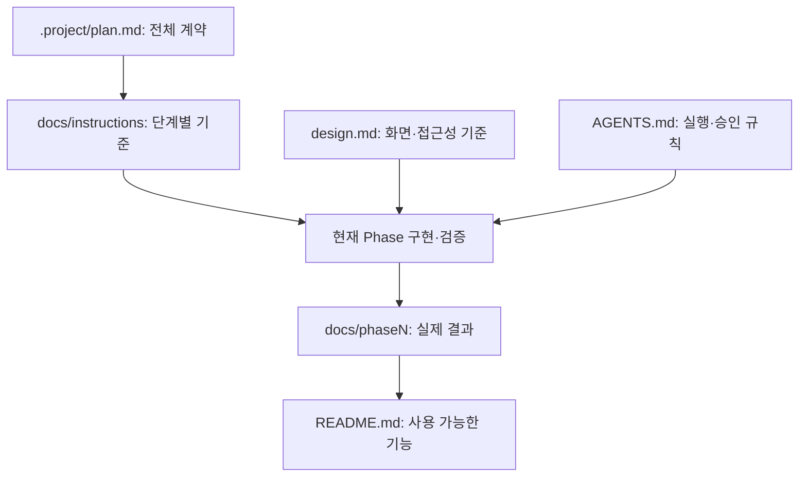
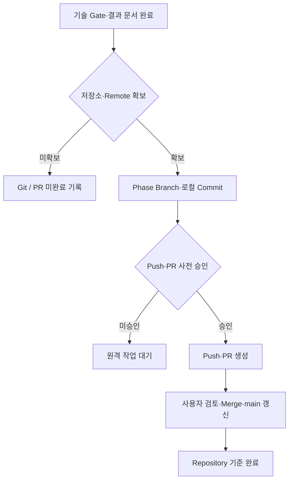

# Codex 프로젝트 운영 체계

적용 범위: SQL Plan Visualizer 프로젝트 개발 규칙.
최상위 경계: 사용자 대화의 명시적 지시·승인과 전역 승인·보안 정책.
프로젝트 문서·스킬을 근거로 한 권한 확대 금지.

## 1. 문서 체계



프로젝트 문서 우선순위: 사용자 현재 명시적 지시 → `.project/plan.md` →
현재 Phase 지침 → `design.md` → `AGENTS.md` → `README.md`.
모든 문서에 대한 전역 승인·보안 경계의 우선 적용.

| 문서 | 역할 |
| --- | --- |
| `.project/plan.md` | 목적·범위·아키텍처·Phase·최종 완료 기준의 계약 |
| `AGENTS.md` | 실행·승인·검증·Git 운영 규칙 |
| `design.md` | 화면·접근성·안전한 렌더링 기준 |
| `docs/instructions/phaseN-*.md` | 해당 단계의 구현·Fixture·실행 검증·Gate |
| `docs/phaseN-*.md` | 실제 명령·결과·한계·실패 수정·Gate 판정 |
| `README.md` | 현재 사용 가능한 기능·명령·제약 안내 |

문서 작성 기준: 짧은 명사형 문장, 가까운 주어·서술어 배치, 관계·흐름의 그림 표현.
검증 기록 기준: 실제 실행 결과만 기록. 과거 수치의 실행 시점 유지.
완료 문서 생성 시점: 해당 Phase 기술 Gate 전체 통과 후.
후속 Phase 선반영 및 미검증 결과의 완료 표기 금지.

## 2. 초기 구조와 환경 변수

다음 구조의 기준 시점: Phase 0 시작 시점의 초기 계약.

```text
sql-plan-visualizer/
├── AGENTS.md
├── README.md
├── design.md
├── pyproject.toml
├── uv.lock
├── .python-version
├── .gitignore
├── .project/plan.md
├── docs/instructions/phase0-feasibility.md ~ phase10-recommendation.md
├── fixtures/sql/simple-select.sql, join.sql, aggregate.sql
└── tests/
```

Phase 0 허용 범위: 해당 Feasibility 검증에 필요한 최소 코드·Fixture.
Phase 1 이후 구조의 생성 조건: Phase 0 기술 Gate 통과.

| 단계 | 환경 변수 기준 |
| --- | --- |
| Phase 0~3 | DB·LLM 환경 변수 요구 없음 |
| Phase 4~6 | `SQLPVI_DATABASE_URL` 도입 |
| Phase 7 이후 | Vendor별 URL 도입, 기존 PostgreSQL URL 호환 유지 |

`.env`: Git 제외 대상. `.env.example`: 값 없는 Key만 허용.
접속정보·Credential의 로그·HTML·Exception 노출 금지.

## 3. Git / PR 규칙



| 작업 | 담당·조건 |
| --- | --- |
| Phase Branch | `feat/phaseN-*` 기준의 작업 브랜치 사용 |
| 로컬 Commit | Phase 내부의 의미 있는 변경 단위 |
| Push·PR 생성 | 사용자 사전 승인 범위에서 Codex 수행 |
| PR Merge·main 전환·Pull | 사용자 수행 |
| Codex의 Merge·main 갱신 | 사용자 명시적 요청 없는 수행 금지 |

기존 사용자 승인 범위의 유지와 불필요한 재승인 요청 금지.
강제 Push·히스토리 재작성 등 별도 승인 대상에 대한 일반 Push 승인의 확대 적용 금지.

기술 완료: Phase Gate 통과와 완료 문서·README 반영.
Repository 완료: 기술 완료, Git/PR 절차, 사용자 확인·Merge의 충족.
저장소·Remote 부재 또는 원격 작업 미승인 시 상태: 기술 완료와 Git/PR 미완료의 분리 보고.

## 4. 표준 작업 요청

```text
AGENTS.md, .project/plan.md, 해당 Phase 지침, design.md 확인.
현재 Phase 범위 내 구현·검증.
모든 기술 Gate의 실제 실행 확인.
완료 문서·README에 실제 결과만 반영.
Push·PR의 기존 사용자 승인 범위 확인.
PR Merge·main 갱신 제외.
```
