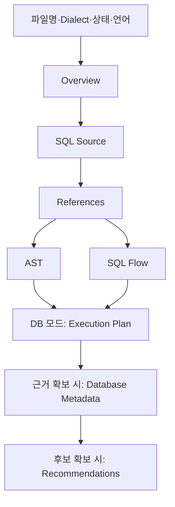

# HTML 리포트 설계

범위·Gate 기준: [기획서](.project/plan.md)와 해당 Phase 지침.

## 화면 구성

그림의 Plan·Metadata·Recommendation: 표시 조건을 가진 선택 영역.

| 영역 | 표시 기준 |
| --- | --- |
| 헤더·Overview·Source·References·AST·SQL Flow | 기본 표시 |
| Execution Plan | DB 실행 계획 확보 |
| Database Metadata | Catalog 근거 확보 |
| Recommendations | 확인된 개선 후보 확보 |

헤더 내용: 입력 파일명·Dialect·PARSED 또는 오류 상태.
출처 구분: STATIC·DATABASE·RECOMMENDATION.
참조 상태 구분: RESOLVED·AMBIGUOUS·UNRESOLVED.
SQL Flow의 의미: SQL 구조. 실제 DBMS 실행 순서와의 구분.

개선 후보 내용: 관측 근거·이유·조건·한계·검증 방법·텍스트 전용 검증 SQL.
실행·적용 버튼 제공 금지.

## 상호작용

| 조작 | 동작 |
| --- | --- |
| Language 선택 | 한국어·English 전환과 문서 lang 갱신 |
| SQL 토큰 Hover·키보드 Focus | 동일 Source Range의 참조·AST·Flow 강조 |
| AST details / summary | 상세 트리 펼침·접힘 |
| 개선 후보 근거 링크 | 해당 실행 계획 노드로 이동 |

언어 선택 보존: 브라우저 Storage 사용 가능 시 유지.
번역 제외 대상: SQL 원문·식별자·분석 코드·Vendor 필드.
상태 코드: 원래 코드와 한국어 설명의 병기.
Source Metadata 없는 노드: 임의 연결 생성 금지.
SVG 연결선: 장식 요소. 텍스트 관계의 병행 제공.

## 접근성·반응형

- 기본 정보: lang·UTF-8·viewport·순차적 제목·skip link.
- 조작 조건: 키보드 접근과 가시적인 Focus 표시.
- 상태 표현: 색상만을 사용한 구분 금지.
- 작은 화면: 한 열 배치와 긴 SQL·표의 컨테이너 내부 스크롤.
- 본문 대비 기준: WCAG AA.
- 움직이는 Animation: 미사용.

## 안전성

| 대상 | 기준 |
| --- | --- |
| SQL·식별자·파일명·오류·DB Metadata | HTML Escape |
| 동적 문자열 | textContent 사용, innerHTML 직접 삽입 금지 |
| script 내부 JSON | 꺾쇠·앰퍼샌드의 Unicode Escape |
| CSS·JS | 문서 내부 포함 |
| Font·CDN·네트워크 | 외부 필수 의존 없음 |
| 접속 URL·Credential | Report 모델 포함 금지 |
| 출력 경로 | 입력 SQL의 덮어쓰기 방지 |
