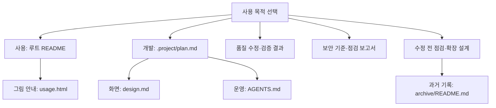

# 문서 맵

현재 사용법·작업 계약·과거 실행 기록의 구분.
정리 기준일: 2026-11-19.

## 현재 기준

| 목적 | 시작 문서 | 관리 범위 |
| --- | --- | --- |
| 설치·CLI·DB 지원 범위 | [README](../README.md) | 현재 실제 동작 |
| 처음 사용·대화 요청·결과 열기 | [그림 사용 안내](usage.html) | Skill·CLI 사용 순서와 DB 모드 구분 |
| 보안 경계·공개 범위 | [보안 기준](../SECURITY.md) | 입력·CSP·DB 연결·Secret·Fixture 기준 |
| 보안 점검·출시 전 확인 | [2026-11-18~19 보안 보고서](security.html) | 수정·검사·비대상·미확인 항목 |
| 기능 범위·아키텍처·안전 계약 | [작업 계약](../.project/plan.md) | 구현 판단의 원본 |
| HTML 보고서·접근성 | [화면 설계](../design.md) | 제품 화면 기준 |
| 실행·승인·Git 운영 | [AGENTS](../AGENTS.md) | 작업 규칙 |
| 품질 수정·검증 범위 | [2026-11-16 수정 기록](audit-fixes-2026-11-16.md) | SQL Flow·참조·설치 구분·테스트 개선 |
| 수정 전 문제·확장 순서 | [2026-11-15 전체 점검](architecture-review-2026-11-15.md) | 당시 재현 결과와 후속 설계 제안 |

문서 충돌 시 작업 규칙의 우선순위 적용. 점검 제안을 구현 완료나 승인으로 간주하지 않는 기준.

## 과거 근거

| 자료 | 역할 |
| --- | --- |
| [과거 기록 목록](archive/README.md) | Phase별 지침·실행 결과·기획 정리본의 연결 |
| [작업 경위 HTML](index.html) | 2026-11-04~07의 요청·변경·검증·설치 실패 기록 |
| [샘플 보고서](examples/hash-spill.html) | 당시 합성 데이터의 실제 결과 예시 |

과거 기록의 날짜·수치·한계 보존. 옛 실행 환경을 현재 상태로 사용하는 방식의 제외.
기존 파일·URL 유지. 새 사용법의 복제와 과거 결과의 덮어쓰기 제외.

## 갱신 위치

1. 기능·안전 계약 변경: `.project/plan.md`에 기준 반영.
2. 사용 가능한 기능 변경: 루트 README에 명령·제약 반영.
3. 화면 계약 변경: `design.md`에 반영.
4. 실제 실행·실패 기록: 날짜가 있는 결과 문서에 추가.
5. 보관 기획서·옛 Phase 결과: 현재 사용법을 복제하는 추가 갱신 제외.
