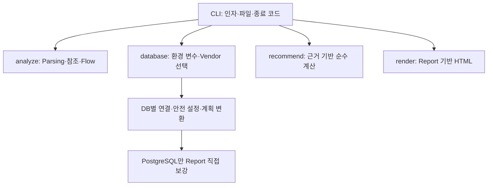
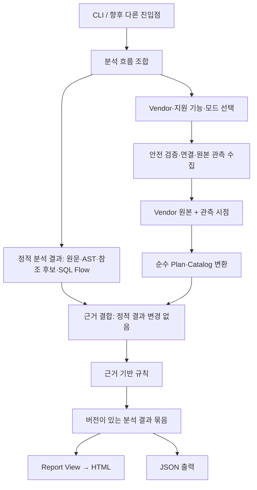

# 프로젝트 전체 점검과 확장 설계

기준일: 2026-11-15. 코드 기준: `26ce0c9`.
후속 변경: [2026-11-16 수정·검증 기록](audit-fixes-2026-11-16.md). 아래 문제·수치는 수정 전 점검 당시의 기록.
대상: 제품 Python 15개·1,239줄, JS·CSS·HTML 템플릿, 테스트 Python 14개·1,992줄, 설정·Fixture·문서 체계.

SQLPVI의 역할: SQL 파일의 구조와 실제 DB 실행 계획을 연결하는 로컬 CLI 도구.
예상 사용량: 개발자 한 명의 단일 SQL 분석. 다중 사용자 서버·상시 모니터링 부하는 이번 판단의 전제에서 제외.

**판정: 현재의 단일 패키지 유지. 우선순위는 SQL Flow 정확성 2건과 분석 결과의 변경 경계 정리.**

제품 코드·테스트·의존성 변경은 이번 점검 범위에서 제외. 문서 맵과 과거 기록의 분류는 반영.

## 1. 점검 결과

### 반드시 수정

#### 1. 윈도 함수의 일반 집계 표시

- 역할: SQL 구조를 `Scan`·`Aggregate`·`Project` 등의 연산으로 표현.
- 문제: `SUM(amount) OVER (...)`를 일반 `Aggregate`로 표시. 윈도 계산과 행을 묶는 집계의 구분 누락.
- 최소 조치: 지원 범위 검사 후 명시적인 제한 처리. 윈도 지원 시 `Window`와 일반 집계의 별도 모델·Fixture 추가.
- 유지 시 영향: 사용자가 SQL Flow를 보고 행의 처리 관계를 잘못 이해할 가능성.

근거: [집계 판별](../src/sqlpvi/analyze.py#L178), [Query 허용 경계](../src/sqlpvi/parser.py#L28).

```sql
SELECT SUM(amount) OVER (PARTITION BY customer_id) FROM orders;
```

직접 확인 결과: `PARSED`, `Scan → Aggregate → Project`.
행을 유지하는 윈도 함수와 일반 집계의 의미 차이: [PostgreSQL 공식 설명](https://www.postgresql.org/docs/18/tutorial-window.html).

지원하지 않는 구문의 제한은 Parser 성공 상태와 별도 표현 필요. `PARSED`를 DB 실행 성공으로 바꾸는 방식은 제외.

#### 2. 집합 연산 뒤 정렬·행 제한 누락

- 역할: `UNION` 등의 입력과 후속 연산을 SQL Flow로 연결.
- 문제: 집합 연산 분기에서 연산 하나만 생성. 뒤에 있는 `ORDER BY`·`LIMIT`의 처리 누락.
- 최소 조치: 집합 연산에도 공통 후속 절 처리 적용. 미지원 형태는 조용히 생략하지 않고 명시적인 제한 처리.
- 유지 시 영향: 정상 입력의 정렬·출력 행 제한을 빠뜨린 시각화 생성.

근거: [집합 연산 분기](../src/sqlpvi/analyze.py#L139), [다른 분기의 절 처리](../src/sqlpvi/analyze.py#L166).

```sql
SELECT 2 AS x
UNION ALL
SELECT 1 AS x
ORDER BY x
LIMIT 1;
```

직접 확인 결과: `PARSED`, 노드 목록 `[Project, Project, Union]`. `Sort`·`Limit` 없음.

### 확장 전에 정리

#### 3. Catalog 재적용 시 원래 참조 후보의 소실

- 역할: DB Catalog 근거로 모호한 Column 참조의 보강.
- 문제: `bind_catalog`가 `candidates`·`status`·`basis`를 덮어씀. 두 번째 Catalog에는 첫 번째에서 지운 후보를 다시 검토할 수 없는 상태.
- 최소 조치: 정적 후보 유지와 DB 보강 결과의 분리. 임시 호출 규칙은 Catalog마다 새 `analyze` 결과 사용.
- 유지 시 영향: 향후 새로고침·여러 DB 비교에서 같은 SQL의 연결 결과가 분석 이력에 따라 달라짐.

근거: [후보 덮어쓰기](../src/sqlpvi/metadata.py#L76), [Metadata 누적](../src/sqlpvi/metadata.py#L45).

직접 확인한 순서:

| 단계 | `name` 보유 Table | 결과 |
| --- | --- | --- |
| 정적 분석 | Catalog 없음 | `AMBIGUOUS`, 후보 `c`, `o` |
| 첫 Catalog | `customers c` | `RESOLVED`, 후보 `c` |
| 같은 Report의 두 번째 Catalog | `orders o` | `UNRESOLVED`, 후보 없음 |
| 새 Report의 두 번째 Catalog | `orders o` | `RESOLVED`, 후보 `o` |

기본 CLI의 새 Report 단일 수집은 이 재사용 경로와 구분. 현재 분석 결과 재사용 API의 제약으로 분류.

#### 4. 정적 CLI의 PostgreSQL Driver 의존

- 역할: CLI에서 선택한 DB의 수집기로 연결.
- 문제: `cli → database → db.postgres → psycopg`의 즉시 import. DB 접속 없는 정적 CLI도 PostgreSQL Driver 부재 시 시작 실패.
- 최소 조치: PostgreSQL Driver와 Catalog 수집 코드의 지연 로딩. 선택하지 않은 DB 부품 없이 정적 CLI를 실행하는 계약 테스트 추가.
- 유지 시 영향: Core 전용 설치와 다른 DB만 사용하는 배포의 분리 불가.

근거: [CLI import](../src/sqlpvi/cli.py#L10), [Vendor import](../src/sqlpvi/database.py#L6), [Driver import](../src/sqlpvi/db/postgres.py#L5).

직접 확인: 별도 Python 프로세스의 `sys.modules['psycopg'] = None` 조건에서 `sqlpvi.cli` import 실패, exit 1.
설치된 Driver의 삭제는 미수행. 현재 전체 의존성 설치 환경의 정상 실행과 분리한 점검.

#### 5. 기본 설치에 개발 도구·전체 DB 부품 포함

- 역할: 배포·설치 시 필요한 패키지 선언.
- 문제: `pytest`·`Ruff`가 제품 실행 의존성에 포함. DB Driver 세 종류도 모든 설치에 필수.
- 최소 조치: 개발 도구는 개발 그룹, DB Driver는 Vendor별 선택 의존성으로 분류. 버전 변경 없이 분류부터 검증.
- 유지 시 영향: 정적 분석만 사용할 때도 테스트 도구·DB 전용 패키지의 설치 실패에 영향받음.

근거: [의존성 선언](../pyproject.toml#L6). 제품 코드의 `pytest`·`ruff` import 없음.
SQLGlot·Jinja2·세 Driver의 실제 사용 확인. 사용 중인 Driver를 불필요한 코드로 삭제하는 제안은 아님.

#### 6. Parser 내부 정보의 부재를 고정한 테스트

- 역할: 초기 SQLGlot의 Source Mapping 가능 범위 확인.
- 문제: `table.meta == {}`를 요구. Parser가 Table 위치 정보를 더 잘 제공해도 실패하는 조건.
- 최소 조치: `source_range`의 유효 범위·원문 연결 계약 검증. 과거 Parser 관측값은 기록으로 보존.
- 유지 시 영향: 정상적인 위치 정보 개선이 회귀 실패로 분류되고 Parser 교체·업그레이드의 불필요한 제약 발생.

근거: [빈 Metadata 고정](../tests/test_phase0_feasibility.py#L102), [자체 Metadata도 읽는 제품 코드](../src/sqlpvi/parser.py#L33).

초기 실험용 테스트·`phase0_probe.py`의 목적 분류 필요. 입력 보존·악성 문자열 검사는 제품 계약 검사로 유지.

#### 7. 동작보다 HTML 모양·Driver 호출 위치를 고정한 테스트

- 역할: HTML 출력과 안전한 DB 수집 순서의 검증.
- 문제: `<script>` 개수 1개, 특정 문장의 첫·끝 인덱스 등을 고정. 기능이 같은 HTML 분할이나 준비 SQL 추가에도 실패 가능.
- 최소 조치: DOM의 의미·원문 보존·외부 실행 차단과 안전 선후 관계의 검증. 브라우저의 언어·강조·근거 링크 동작은 별도 회귀로 관리.
- 유지 시 영향: 허용되는 구현 변경도 회귀 수정 필요. 반대로 JS의 실제 기능 고장은 HTML 문자열 검사만 통과할 수 있음.

근거: [Script 개수](../tests/test_html.py#L54), [추천 HTML의 Script 개수](../tests/test_recommend.py#L161), [호출 인덱스](../tests/test_sqlserver.py#L136).

유지할 안전 계약: Query 전 제한 설정·권한 확인, SHOWPLAN ON 뒤 Query 전달, 예외 시 OFF·Rollback·연결 종료, Credential 비노출.
안전 순서 검사를 없애는 방식은 제외. 고정된 호출 위치와 필요한 선후 관계의 구분.

#### 8. 현재 기준과 과거 문서의 역할 중복

- 역할: 사용법·설계 계약·단계별 실행 근거의 안내.
- 문제: `.project/plan.md`와 긴 `기획서.md`의 현재 기준 중복. 실제 저장소가 있는데도 과거의 저장소 부재 문구가 현재 상태로 남은 사례 확인.
- 최소 조치: 현재 계약은 `.project/plan.md`, 사용법은 README로 고정. 기획 정리본·작업 HTML·Phase 기록은 보관 분류와 문서 맵으로 연결.
- 유지 시 영향: 수정할 문서 선택의 혼란과 오래된 상태의 반복 전파.

이번 반영: [문서 맵](README.md), [과거 기록 목록](archive/README.md), 현재 계약의 잘못된 상태 문구 제거.
기존 URL·파일 위치와 과거 시험 수치는 보존. 보관 분류를 이유로 실행하지 않은 검증을 완료로 변경하지 않음.

## 2. 구조와 책임의 현재 평가



| 경계 | 현재 상태 | 판단 |
| --- | --- | --- |
| Parser/Vendor 원본과 Renderer | Report 모델로 분리 | 유지 |
| Recommendation과 DB 접속 | 순수 계산, 접속 없음 | 유지 |
| CLI와 파일 I/O | 81줄에 분석 순서까지 조합 | 현 규모에서는 유지. 다른 진입점 추가 시 흐름만 추출 |
| 정적 분석 | 참조와 Flow 구축이 한 함수에 혼합 | 두 정확성 수정 뒤 독립된 책임 단위로 분리 |
| DB 수집 | 연결·보호·원본 변환이 Vendor 파일에 함께 존재 | 외부 연결부와 순수 변환부의 테스트 경계 분리 |
| Metadata | PostgreSQL 조회와 공통 참조 보강이 같은 모듈 | Vendor 조회와 순수 결합 연산의 분리 |
| 공통 Report | 정적 결과와 관측·추천의 가변 컨테이너 | 재분석을 위한 원본 분석·관측·보강 결과 분리 |

DB 접속 보호와 SQL Allowlist는 현재 경계에서 필요한 검증. 중복처럼 보인다는 이유로 삭제할 대상에서 제외.

## 3. 의존성 정리안

| 패키지 | 실제 용도 | 제안 위치 |
| --- | --- | --- |
| SQLGlot | Parsing·참조·DB SQL 검사 | Core 필수 |
| Jinja2 | Standalone HTML 렌더링 | Core 필수 |
| Psycopg + binary | PostgreSQL 연결·Catalog | `postgres` 선택 기능 |
| PyMySQL | MariaDB 연결 | `mariadb` 선택 기능 |
| pymssql | SQL Server 연결 | `sqlserver` 선택 기능 |
| pytest | 테스트 실행 | 개발 그룹 |
| Ruff | 정적 검사·서식 | 개발 그룹 |

목표: 기본 직접 의존성 7개 → 2개. 개발용 2개와 선택 DB용 3개의 분류 변경.
DB 기능을 포함한 전체 개발 환경의 필요 패키지 수 감소와는 다른 목표.

분류 문법 근거: [uv 의존성 그룹·선택 의존성](https://docs.astral.sh/uv/concepts/projects/dependencies/).
분류·Lock 변경은 후속 구현 대상. 이번 작업의 `pyproject.toml`·`uv.lock` 변경 없음.

추가 설계 항목:

- `.python-version`: 재현할 개발 인터프리터의 고정 위치.
- `requires-python ==3.13.15`: 현재 배포의 정확한 패치 버전 제한. 호환 범위 확대는 해당 범위의 검사 후 별도 변경.
- DB 이미지: PostgreSQL 패치 태그와 MariaDB minor·SQL Server `latest`의 재현 수준 차이 존재. 다음 통합 환경 확정 시 검증한 이미지 식별자 보관.
- 새 Framework·Graph Library·LLM API 패키지의 도입 근거 없음.

## 4. 테스트 구조 정리안

| 층 | 보장할 동작 | 피할 고정 |
| --- | --- | --- |
| Parser 계약 | 원문 범위·허용 Statement·오류 | 상위 노드 Metadata가 반드시 빈 상태 |
| 정적 분석 | 참조 후보·Flow 의미·미지원 구문 처리 | 모든 구문이 `Select` 루트라는 일반화 |
| 순수 Vendor 변환 | Operator·트리·미측정 값·Vendor 속성 | DB Cost·시간의 환경 공통 정답 |
| 수집기 | 안전 선후 관계·자원 정리·오류 마스킹 | 관계없는 준비 SQL까지 포함한 절대 호출 인덱스 |
| Renderer | 원문·링크·Escape·Standalone | Script 개수·속성 배치 같은 내부 포장 |
| 브라우저 | 언어·강조·근거 이동·모바일 | HTML 문자열의 존재만으로 동작 판정 |
| 설치 | Core만·Vendor별 설치·CLI 실행 | 기존 editable 환경의 성공으로 새 설치 대체 |

먼저 추가할 계약 사례:

1. 윈도 함수와 일반 집계의 구분.
2. 집합 연산 뒤 정렬·Offset·Limit의 표현 또는 명시적 미지원.
3. 같은 정적 분석에 서로 다른 Catalog를 적용한 결과의 독립성.
4. PostgreSQL Driver 부재의 정적 CLI 실행.

통합 검사는 Core 단위 검사와 별도 실행. Driver가 없다는 이유로 제품 계약 검사 전체를 조용히 Skip하는 방식은 제외.
선택 기능별 설치·검사 조합과 전체 DB 조합의 구분 필요.

## 5. 확장을 위한 목표 설계

목표: 한 패키지 안에서 입력·정적 분석·관측·근거 결합·출력의 책임 분리.
현재 크기의 서비스 분산보다, 같은 분석 결과를 재사용할 수 있는 데이터 경계 우선.



### 5.1 데이터 경계

| 결과 | 담을 내용 | 변경 원칙 |
| --- | --- | --- |
| StaticAnalysis | SQL·AST·정적 후보·Flow·분석 한계 | DB 수집으로 원래 후보를 덮어쓰지 않는 구조 |
| DatabaseObservation | Vendor·모드·계획·Catalog·관측 시점·지원 기능 | DB 사실과 수집 실패·미지원의 구분 |
| BindingResult | 정적 참조 ID와 근거·해결 상태 | 관측별 독립 생성 |
| Recommendation | 실제 근거 ID·조건·한계·텍스트 제안 | 자동 실행 없는 파생 결과 |
| Report View | 화면에 필요한 표현 | SQLGlot·Vendor 원본의 직접 해석 제외 |

원본 계획 보존 항목: Vendor·형식·수집 모드·관측 시점·Parser/Adapter 버전·원본 payload.
연결 문자열·Credential의 결과 포함 금지. 저장 정책은 원본 SQL과 계획에 들어 있는 데이터의 범위 확인 후 확정.
JSON 계약의 `schema_version`과 호환 정책은 외부 소비자 확장 전에 정의.

### 5.2 DB 확장 경계

수집기 계약의 목표 형태: Query·명시적 설정·모드 입력 → 계획·Catalog·경고·원본 관측 반환.
수집기가 전체 `Report`를 직접 고치는 경로 제거.

`estimated`·`runtime`·`catalog` 지원 여부는 Vendor 정의 한 곳에서 선택.
CLI·라우터의 사용자 오류 안내는 이 정의 사용. DB 수집기 내부의 안전 검증은 별도 유지.

현재 세 Vendor는 작은 등록 테이블과 명확한 반환 계약으로 충분.
외부 플러그인 로더·동적 설치·자동 DBMS 판별은 실제 요구 발생 후 검토.

### 5.3 Recommendation 확장 경계

현재 두 규칙의 순수 함수 구조 유지.
규칙별 입력 조건과 Evidence 연결의 독립 검사. Vendor 간 Cost·Operator 이름의 임의 동치화 금지.
향후 SQL·Index 후보 생성은 이 근거 묶음의 소비자로 추가. LLM 호출과 적용 작업은 Core 규칙과 별도 경계.

### 5.4 변경 순서와 완료 조건

| 순서 | 작업 | 완료 조건 |
| --- | --- | --- |
| 1 | SQL Flow 정확성·지원 범위 보완 | 재현 2건과 기존 Flow Fixture 통과 |
| 2 | 정적 결과와 Catalog 보강 분리 | 재적용·관측 변경에도 후보 독립성 확인 |
| 3 | Driver import·의존성 분류 | Core 전용·Vendor별 새 환경의 CLI 실행 |
| 4 | 분석 흐름·Vendor 반환 계약 정리 | CLI와 직접 함수 호출의 같은 결과·보호 계약 |
| 5 | 원본 관측·JSON 버전·브라우저 검사 | 저장 후 재해석·출력·실제 UI의 재현성 |
| 6 | MariaDB·SQL Server Runtime 등 확장 | Vendor별 실제 실행 보호·통합 검증 후 지원 표시 |

각 단계에서 기존 CLI 옵션·출처·입력 보존·Credential 보호의 회귀 확인.
추천 자동 적용·프로덕션 자동 튜닝은 기존 범위 밖 유지.

### 5.5 책임 분리 후의 구조 예시

아래 경계가 실제로 필요해지는 변경 단계에서만 파일 이동. 이번 점검에서 구현 폴더 생성 없음.

```text
sqlpvi/
├── cli.py                  # 인자·파일·종료 코드
├── application.py          # 분석·관측·보강·출력 흐름의 조합
├── models.py               # 분석·관측·근거 결과 계약
├── analysis/
│   ├── parser.py           # SQLGlot 연동과 Source Mapping
│   ├── references.py       # 정적 참조 후보
│   └── flow.py             # 지원 구문의 SQL Flow
├── db/
│   ├── registry.py         # Vendor·Dialect·지원 모드
│   ├── safety.py           # 입력 SQL 안전 경계
│   └── postgres.py, mariadb.py, sqlserver.py
├── binding.py              # 정적 후보와 관측 근거의 순수 결합
├── recommend.py            # 실제 근거의 점검 규칙
├── render.py               # 출력 모델과 HTML 표현
└── templates/, assets/
```

SQLGlot 의존 코드는 정적 분석 경계 안에서 관리. Parser 교체를 가정한 별도 중간 언어의 선행 구현은 제외.
Vendor 파일 내부에서도 외부 I/O와 순수 변환 함수의 구분. 파일 수보다 독립된 입력·반환 계약 우선.

## 6. 문서 정리의 반영 범위

- [현재 문서 맵](README.md) 추가: 용도별 시작 문서의 지정.
- [과거 기록 목록](archive/README.md) 추가: Phase 0~10의 지침·결과와 선택 기록 연결.
- 루트 `기획서.md`: 과거 기획 정리본으로 분류. 현재 작업 계약의 원본과 분리.
- 작업 경위 HTML·선택 HTML: 보관 기록의 기준일 표시. 기존 URL 유지.
- README: 현재 사용 안내·이번 점검 결과·보관 기록의 연결 분리.
- 과거 파일 이동·삭제 없음. 제품 코드·테스트·패키지·Lock 변경 없음.

## 7. 실제 검증과 한계

| 항목 | 실제 결과 |
| --- | --- |
| DB 제외 회귀 | 2026-11-15, `206 passed, 52 deselected in 11.94s`, exit 0 |
| 정적 분석 재현 | 윈도 함수·집합 연산의 Flow 누락/오표시 확인 |
| Catalog 재적용 재현 | 같은 Report와 새 Report의 후보 결과 차이 확인 |
| Driver 분리 재현 | 별도 프로세스의 psycopg import 차단 시 정적 CLI import 실패 확인 |
| Ruff | `ruff check src tests` 통과. 서식 검사 `29 files already formatted`, exit 0 |
| 문서 연결 | 38개 문서·로컬 링크/HTML fragment 183개 검사 통과. 대상 누락·중복 HTML ID 없음 |
| 보관 HTML | 390px·1366px 화면의 가로 넘침 없음. 탭 10개·이동 정상, 외부 Resource·Console Error/Warning 없음 |
| 실제 DB 검사 | Fixture 포트 55432·53306·14330 닫힘. 통합 테스트 52개 미실행·통과 수에서 제외 |
| 새 환경 설치·Wheel 검증 | 미실행. 기존 설치 환경의 검사 결과와 구분 |

실행한 회귀 명령:

```powershell
.\.venv\Scripts\python.exe -m pytest tests -m 'not integration' -q --basetemp artifacts/pytest-audit-20261115-01 -p no:cacheprovider --tb=short
```

점검 제한: 실제 DBMS의 새 계획·잠금·권한, 신규 설치, 대규모 Query·동시 사용자 부하의 실측 없음.
긴 과거 문서는 문서 역할·중복·상태·링크 중심으로 확인. 과거의 모든 DB 명령을 재실행한 감사는 아님.

최종 판정: 정확성 2건의 수정부터 진행. 정적 결과의 보존과 선택 의존성 분리 후 기능 확대.
경량화 후보: 기본 직접 의존성 5개 분리 가능. 삭제할 제품 코드의 줄 수는 미산정.
