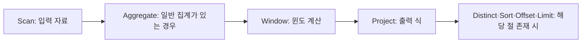
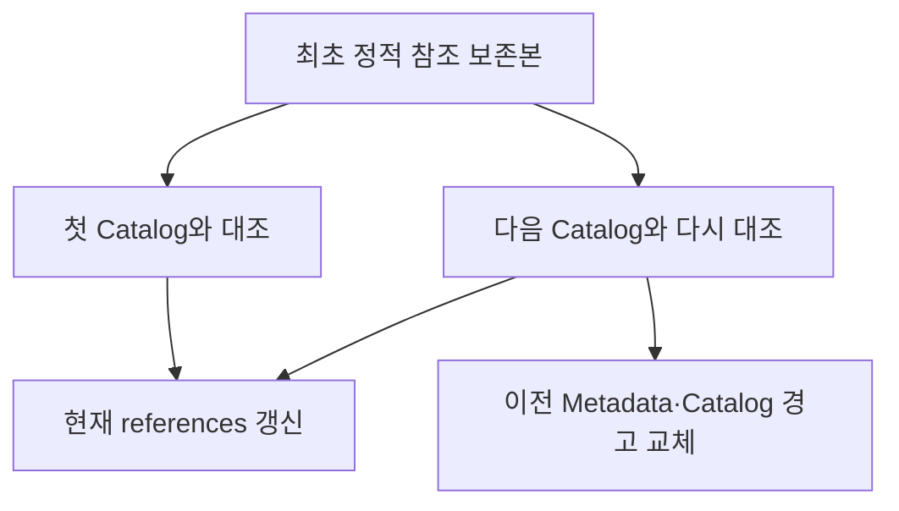

# SQL Flow·참조·의존성 수정 기록

검증일: 2026-11-16. 대상: [전체 점검](architecture-review-2026-11-15.md)의 코드·테스트 문제 7건.
문서 체계 문제 1건: 앞선 문서 맵·과거 기록 분류에서 정리.

확인 결과: **DB 제외 229 passed**, Ruff·Lock 검사 통과, 브라우저 계약 검사 통과.
남은 확인: 실제 DB 통합 검사 52개와 새 환경의 전체 설치.

## Step 1. SQL Flow의 빠진 의미 보완

### 윈도 계산과 일반 집계의 구분

`SUM(amount) OVER (...)`의 표시: `Aggregate`에서 `Window`로 수정.
행을 묶는 일반 집계와 윈도 계산의 별도 표현.



일반 집계가 없는 윈도 SQL: `Scan → Window → Project`.
`SUM(SUM(amount)) OVER ()`: 내부 일반 집계와 외부 윈도 계산을 모두 유지.

이름 있는 `WINDOW w AS (...)`: 계산 정의로 취급. 실제 `OVER w`의 중복 노드 생성 방지.
Subquery의 윈도 계산: 해당 Select에서만 생성. 바깥 Select의 중복 집계 방지.

Select의 `Project` 위치: 윈도 계산 다음, Distinct·정렬·행 제한 이전으로 정리.
SQL Flow의 의미: 논리적 연산 관계. 실제 DBMS의 물리 실행 순서 보증 제외.

### 집합 연산 뒤 후속 절의 보존

적용 대상: `UNION`·`INTERSECT`·`EXCEPT`.
두 입력의 결합 이후 `ORDER BY`·`OFFSET`·`LIMIT` 연결.

예: `SELECT 2 AS x UNION ALL SELECT 1 AS x ORDER BY x LIMIT 1 OFFSET 2`.
출력 관계: `Union → Sort → Offset → Limit`.

변경 코드: [analyze.py](../src/sqlpvi/analyze.py), [번역](../src/sqlpvi/assets/report.js).
회귀 사례: [test_static_analysis.py](../tests/test_static_analysis.py).

## Step 2. Catalog 재적용의 원래 후보 보존

문제 사례: 첫 Catalog에서 `name`을 `customers`로 확정한 뒤, 두 번째 Catalog에서 `orders`에만 해당 Column이 있는 상황.
이전 구현의 영향: 첫 판정으로 줄어든 후보를 다시 사용해 새 근거의 후보를 찾지 못하는 문제.



| Report 필드 | 역할 |
| --- | --- |
| `static_references` | 최초 정적 후보·상태·출처의 깊은 복사본 |
| `references` | 현재 근거를 반영한 참조. 기존 호출 인터페이스 유지 |

Catalog 재적용의 시작점: 항상 정적 보존본.
불완전한 Catalog의 처리: 확인되지 않은 참조의 정적 상태 복원.
존재하지 않았던 Column의 후속 발견: 새로운 Catalog에 따른 재판정.

Metadata 재수집: 이전 목록과 이 기능이 만든 경고의 교체.
다른 분석 경고의 보존. 기존 Reference 객체를 보유한 호출 코드의 동작 유지.

JSON 변경: `static_references` 필드 추가. 기존 `references` 필드 유지.
정확한 JSON Key 목록을 강제하는 외부 코드의 대응 필요.

변경 코드: [models.py](../src/sqlpvi/models.py), [metadata.py](../src/sqlpvi/metadata.py).
반복 적용·가시성 변경·경고 갱신 검사: [test_metadata.py](../tests/test_metadata.py).

## Step 3. 설치 범위와 Driver 로딩의 분리

| 사용 목적 | 직접 의존성 | 선택 |
| --- | --- | --- |
| 정적 분석·HTML | SQLGlot·Jinja2 | 기본 Core |
| 개발 검사 | pytest·Ruff | `dev` 그룹 |
| PostgreSQL | Psycopg 3 | `postgres` Extra |
| MariaDB | PyMySQL | `mariadb` Extra |
| SQL Server | pymssql | `sqlserver` Extra |

기존 패키지 버전 16개 유지. 신규 패키지 도입·버전 업그레이드 없음.
`uv.lock` 변경 범위: 필수·개발·선택 의존성의 연결 정보.
Python 3.13.15·setuptools 84.2.1 기준 유지.

PostgreSQL Driver의 로딩 시점: 실제 DB 수집 경로 진입 시점.
Driver 부재 시 결과: 해당 Extra를 안내하는 설정 오류.
MariaDB·SQL Server의 안내 문구도 같은 형식으로 통일.

SQL 허용 검사·최소 권한·Read-only·Timeout·Credential 보호의 유지.
Integration Driver Fixture의 지연 로딩으로 DB 없는 테스트 수집 지원.

현재 환경 보존: 기존 `.venv`의 재동기화 미실행.
새 기본 설치의 의존성 분류 확인과 기존 설치의 실행 성공은 별도 항목.

설치 명령: [README](../README.md#설치와-정적-분석).
설정·계약 검사: [pyproject.toml](../pyproject.toml), [test_core_install.py](../tests/test_core_install.py).

## Step 4. 구현 세부 대신 동작을 확인하는 테스트

| 이전 고정 조건 | 현재 확인 대상 |
| --- | --- |
| `Table.meta == {}` | 유효한 Source Range. 상위 노드의 정상 Metadata 허용 |
| Script 개수·HTML 속성 배열 | 원문 보존·위험 문자열의 비실행·내부 링크 대상 |
| SQL 호출의 절대 위치 | 안전 검사 → 계획 조회의 상대 순서와 정리 동작 |
| 테스트 수집 단계의 Driver import | 선택한 실제 DB 검사 실행 시 Driver 로딩 |

HTML 구조 검사: 표준 라이브러리 `HTMLParser` 사용.
추가 파서·브라우저 패키지 의존성 없음.

Driver 없는 CLI 검사: 세 Driver의 import를 막은 별도 Python 프로세스 사용.
검사 조합: Vendor 3종 × HTML·JSON. 입력 보존·성공 종료·출력 내용 확인.
DB URL 환경 변수가 있어도 비통합 테스트 수집에는 Driver가 필요 없는 상태 확인.
추가 검증: 같은 import 차단을 적용한 프로세스에서 비통합 테스트 전체 실행. 229개 통과.

### 브라우저 검사

준비 코드: [prepare_report.py](../tests/browser/prepare_report.py).
검사 함수: [report_contract.js](../tests/browser/report_contract.js).
합성 PostgreSQL Runtime Plan의 사용. 실제 DB 접속·Query 실행 없음.

준비 명령:

```powershell
.\.venv\Scripts\python.exe tests/browser/prepare_report.py artifacts/browser-audit-fixes-20261116
.\.venv\Scripts\python.exe -m http.server 18765 --bind 127.0.0.1 --directory artifacts/browser-audit-fixes-20261116
```

실제 실행 방식: 기존 Playwright 도구의 Page를 위 주소로 이동한 뒤 검사 함수 호출.
사용 도구: `browser_run_code_unsafe`의 `filename="tests/browser/report_contract.js"`.
일반 Playwright 환경에서도 파일의 비동기 함수에 `page`를 전달하는 방식.
pytest와 별도 실행. 프로젝트에 Playwright 설치·자동 실행 설정을 추가하지 않은 범위.

| 확인 항목 | 실제 결과 |
| --- | --- |
| SQL 원문·Window 노드 | 보존·표시 통과 |
| 키보드 Focus와 참조 강조 | 연결 동작 통과 |
| 한/영 전환 | 문서 언어·Window 번역·원문 보존 통과 |
| 개선 후보 근거 링크 | 고정 ID에 의존하지 않는 Plan 이동 통과 |
| SQL의 Script 문자열 | 실행되지 않음 확인 |
| 390px·1366px 화면 | 페이지 전체 가로 넘침 없음 |
| 외부 리소스·브라우저 오류 | 요청·실행 오류 없음 |

검사 중 수정: Windows의 시험 SQL 줄바꿈을 LF로 고정.
본문의 `window` 문자열과 실제 노드 제목을 구별하도록 Locator 수정.
제품 기능 오류와 시험 준비·Locator 오류의 구분.

## Step 5. 실제 검증 결과와 남은 확인

현재 설치된 환경에서 실행한 명령:

```powershell
.\.venv\Scripts\python.exe -m pytest tests -m 'not integration' -q --basetemp artifacts/pytest-audit-final-20261116 -p no:cacheprovider --tb=short
.\.venv\Scripts\python.exe -m ruff check src tests
.\.venv\Scripts\python.exe -m ruff format --check src tests
uv --cache-dir .uv-cache --offline lock --check
```

| 검사 | 실제 결과 |
| --- | --- |
| 비통합 pytest | `229 passed, 52 deselected in 7.95s`, exit 0 |
| 세 Driver import 차단 후 비통합 pytest | `229 passed, 52 deselected in 8.28s`, exit 0 |
| Ruff check | `All checks passed!`, exit 0 |
| Ruff format | `33 files already formatted`, exit 0 |
| Lock 검사 | `Resolved 16 packages`, exit 0 |
| 이전 Lock과 버전 비교 | 16개 패키지 버전 일치 |

실제 DB 재검증 미실행: `127.0.0.1:55432`·`53306`·`14330`의 TCP 연결 실패.
통합 검사 52개의 명시적 제외. 과거 258개 통과 기록을 이번 수정의 결과로 대체하지 않는 기준.

새 환경 설치의 첫 실패: Offline 캐시에 필요한 Jinja2 배포 파일 부재.
새 캐시를 사용한 후속 실패: PyPI 파일 다운로드의 Socket 접근 거부, Windows 오류 10013.
이번 변경의 신규 설치·Wheel 빌드 성공은 미확인.
Driver import 차단 검사는 이 설치 검증을 대신하지 않는 기준.

## Step 6. 확장 범위의 유지

유지한 구조: 단일 `sqlpvi` 패키지와 현재 Report·Adapter·Renderer 경계.
이번 수정에서 미도입: 별도 서비스·Plugin 프레임워크·새 Pipeline 계층.

큰 확장의 기준: [전체 점검의 설계 제안](architecture-review-2026-11-15.md).
우선 조치한 범위: 정확성·참조 보존·선택 의존성·테스트 계약.
기존 추적 파일의 삭제·이동 없음. 과거 Phase 문서의 날짜·수치·URL 유지.

## 후속 사용성 개선: 저장 후 자동 분석

사용자 실습의 문제: SQL 수정마다 긴 분석 명령의 재입력 필요.
추가 기능: `analyze --watch`. 최초 실행 후 내용 변경 시 같은 HTML 자동 재생성.
브라우저 확인: F5. 종료: Ctrl+C.

변경 파일: [cli.py](../src/sqlpvi/cli.py), [test_watch.py](../tests/test_watch.py).
사용 안내: [README](../README.md#반복-수정-한-번-실행과-저장-감지), [그림 안내](usage.html#watch).

범위: 정적 HTML. DB 모드·JSON 결합 거부. 추가 의존성·Lock 변경 없음.
변경 감지: 0.5초 간격의 파일 내용 해시 비교. 동일 내용의 불필요한 재분석 방지.
오류 처리: 이전 HTML 유지·터미널 오류 표시·수정 저장 후 복구.
입력 보호: 매 분석 시 원본 덮어쓰기·Hardlink 검사 유지.

2026-11-16 검증: 전체 비통합 `234 passed, 52 deselected`, exit 0. Ruff 통과.
2026-11-18 검증: `pytest tests/test_watch.py`의 `5 passed`, exit 0. Ruff check·format 통과.
실제 설치된 `sqlpvi.exe` 확인: 최초 생성 → SQL 저장 후 갱신 → 문법 오류 시 이전 HTML 유지 → 수정 후 복구.
실제 검증의 입력: `artifacts/watch-smoke-20261118/query.sql`. 사용자의 실습 SQL 변경 없음.
종료 확인 범위: Ctrl+C 처리의 단위 검사 통과. 자동 PTY의 제어문자 전달로는 종료되지 않아 검증 프로세스 경로·PID 확인 후 종료.
실제 DB 재검증·브라우저 자동 새로고침의 미실행.
