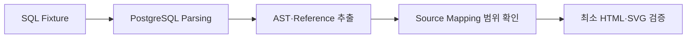

# Phase 0. Feasibility 작업 지침

적용 시점: Phase 0 구현 단계.
Gate 근거: [완료 기록](../phase0-feasibility.md), 2026-11-04 기준.
현재 사용법: [README](../../README.md).

## 1. 작업 기준

공통 기준: `.project/plan.md`와 `AGENTS.md`.
허용 범위: Feasibility 검증용 최소 구현.
후속 Static Analysis·완성형 HTML UI·Database 기능의 선반영 금지.

## 2. 목적과 검증 흐름



## 3. 학습 목표

- PostgreSQL Dialect Parsing·Parser Error 확인
- AST Traversal과 Table·Column·Alias 추출 범위 확인
- Join·Aggregate 구조 확인
- SQL Source와 AST·Reference 연결 범위 확인
- SQLGlot 위치 Metadata 확인
- HTML Escape·Standalone HTML·최소 SVG 확인

## 4. 시작 전 확인

대상: Git 상태·브랜치·Python 버전·pyproject.toml·uv.lock·src·Fixture·Test.
Python 기준: 사용자 승인 버전 3.13.15.
패키지 기준: 정식 배포·Python 호환성 확인·사용자 승인 범위·Lock 고정.

## 5. Fixture

| 파일 | 확인 대상 |
| --- | --- |
| `simple-select.sql` | SELECT·FROM·Table·Column·Alias |
| `join.sql` | JOIN·조건·복수 Relation |
| `aggregate.sql` | 집계 함수·GROUP BY |

## 6. Parsing 검증

PostgreSQL Dialect의 SELECT·FROM·Table·Column·별칭·JOIN·집계·오류 확인.
Parsing 성공과 실제 PostgreSQL 실행 성공의 구분.

## 7. AST 검증

Root·Child Expression과 Table·Column·Join·Aggregate·Alias Node 확인.
SQLGlot Expression을 HTML Renderer 계약으로 직접 고정하는 방식의 금지.

## 8. Reference 검증

Table·Column·Alias·Join 조건·Aggregate 인수의 참조 확인.
정적 근거 부족 시 임의 Table 연결 금지.

## 9. Source Mapping 검증

실제 Fixture의 line·col·start·end 확인.
모든 노드의 완전한 Source Range 가정 금지.
Expression 범위 부재 시 Clause·Reference 단위 축소 가능성 확인.
확인되지 않은 Offset의 임의 계산 금지.

## 10. 최소 HTML 검증

SQL Source·Reference 출력, Source 연결, Escape, SVG, 파일 직접 실행 확인.
완성형 UI 구현 제외.

## 11. HTML 안전성

검증 문자열: `<script>`, `</script>`, `< > & " '`, Unicode.
정상 기준: 문자열 보존, Script 실행 없음, 문서 구조 보존.
완성형 XSS·Serialization 검증: Phase 2 범위.

## 12. 최소 SVG 검증

Source·Reference 연결선, 기본 위치 계산, Inline SVG·Standalone 표시 확인.
Graph Layout Engine 구현 제외.

## 13~16. 구현·제외 범위와 실패 기록

허용 파일: `fixtures/sql/*.sql`, `tests/` 등 현재 검증에 필요한 최소 파일.
제외 대상: 완성형 Parser Adapter·Reference Analyzer·SQL Flow·AST/HTML UI·DB 연결·EXPLAIN·Skill.

실패 기록의 구분: Parsing·AST·Reference·위치 Metadata·Escape·Standalone·SVG.
미확인 결과의 통과 표기 금지.

## 17. 검증 명령

```powershell
uv lock --check
uv run pytest
uv run ruff check .
uv run ruff format --check .
```

현재 전체 검증 명령: [README](../../README.md#전체-검증).

## 18. 기술 Gate

- [x] SQLGlot PostgreSQL Dialect의 목표 SQL Parsing
- [x] AST Traversal
- [x] Table Reference 추출
- [x] Column Reference 추출
- [x] Table Alias 확인
- [x] Column Alias 확인
- [x] Join Condition 확인
- [x] Aggregate Function 확인
- [x] Parser Error 확인
- [x] Source Mapping 범위 확인
- [x] Source·Reference 연결 확인
- [x] 최소 Standalone HTML 생성
- [x] SQL 문자열 안전 출력
- [x] 실제 SVG 연결선 표시
- [x] 핵심 방식의 기술적 장애 없음

체크 기준: 완료 기록의 실제 검증 결과. 미확인 항목 존재 시 기술 완료 판정 금지.
Git/PR 완료 여부의 별도 기록.

## 19~21. 완료 기록과 Git

완료 문서: `docs/phase0-feasibility.md`. 생성 조건: 기술 Gate 전체 통과.
필수 기록: 학습 목표·실습 명령·실제 결과·한계.
미실행 명령·미확인 수치의 기록 금지.

브랜치: `feat/phase0-feasibility`.
PR 제목: `Phase 0: Feasibility`.
Push·PR 생성 조건: AGENTS.md의 사용자 사전 승인 규칙.
