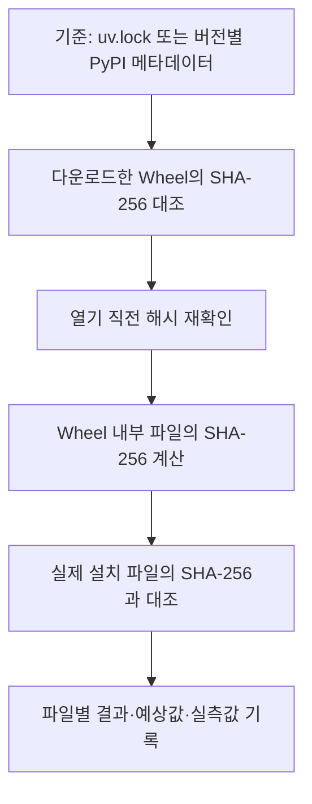
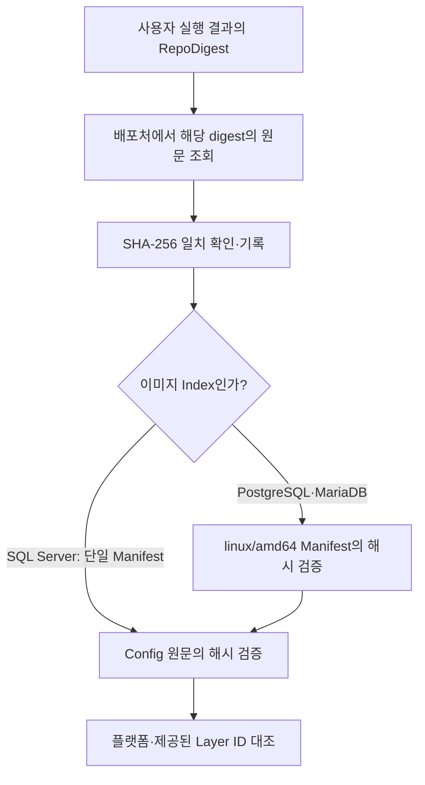

# 외부 리소스 무결성 대조 · 2026-11-21

**패키지 원본 파일 1,992개 일치. 컨테이너 이미지 3종의 공식 digest 일치.**

이미지 검증의 범위: 사용자 실행 결과의 RepoDigest와 배포처 원문·플랫폼·Config 해시 대조.
로컬 Layer 실파일·컨테이너 쓰기 영역·Volume의 내용 대조는 미수행.

검사 대상: 이 프로젝트의 `.venv`와 `compose.yaml`의 이미지 3종.
검사 목적: 기준 해시·배포 원본·설치 파일의 실제 내용 비교.
패키지 실행·설치·업데이트, Lock 변경, 컨테이너 변경, DB 접속의 미수행.

## Step 1. 배포 원본 확보와 해시 확인

설치 버전과 일치하는 Wheel 16개의 PyPI 다운로드.
셸의 HTTP 요청 실패 후 브라우저의 공개 HTTPS 요청 사용.
파일 저장 위치: `artifacts/integrity-2026-11-21/downloads/`.

| 기준 | 대상 | 실제 대조 결과 |
| --- | --- | --- |
| 기존 `uv.lock`의 SHA-256 | 의존성 Wheel 15개 | 전부 일치 |
| PyPI의 해당 버전 메타데이터 SHA-256 | `pip==26.2.1` Wheel 1개 | 일치 |

`pip`의 구분: 기존 환경에 설치된 도구이며 `uv.lock`의 관리 대상 아님.
기준은 이번에 HTTPS로 확보한 PyPI 메타데이터. 과거부터 고정된 Lock 해시와 별도 출처.
메타데이터 원문 해시와 Wheel의 예상·실측 해시 기록.

## Step 2. 실제 설치 파일과 원본 비교

검증된 Wheel을 열기 직전 아카이브 해시 재확인.
압축 내부 파일의 SHA-256과 `.venv` 설치 파일의 SHA-256 직접 대조.
압축 파일의 실행·설치·압축 해제 없는 스트림 읽기 방식.



| 패키지 | 설치 버전 | 원본과 일치한 파일 | 불일치 |
| --- | --- | ---: | ---: |
| colorama | 0.4.6 | 16 | 0 |
| iniconfig | 2.3.0 | 9 | 0 |
| Jinja2 | 3.1.6 | 30 | 0 |
| MarkupSafe | 3.0.4 | 10 | 0 |
| packaging | 26.3 | 28 | 0 |
| pip | 26.2.1 | 475 | 0 |
| pluggy | 1.6.0 | 13 | 0 |
| psycopg | 3.3.7 | 89 | 0 |
| psycopg-binary | 3.3.7 | 18 | 0 |
| Pygments | 2.21.0 | 348 | 0 |
| pymssql | 2.4.6 | 18 | 0 |
| PyMySQL | 1.2.3 | 22 | 0 |
| pytest | 9.1.1 | 88 | 0 |
| ruff | 0.16.8 | 8 | 0 |
| sqlglot | 30.18.0 | 188 | 0 |
| tzdata | 2026.6 | 632 | 0 |
| 합계 | 16개 | 1,992 | 0 |

로컬 프로젝트 `sql-plan-visualizer`: Editable 설치의 자체 코드로 분류. 외부 Wheel 동등성 집계에서 제외.

## Step 3. 설치 메타데이터 기준의 추가 대조

`RECORD`: 설치 파일의 경로·해시·크기를 적은 패키지 메타데이터.
자체 프로젝트를 포함한 17개 배포본의 실제 파일 해시·크기 대조.

| 항목 | 결과 |
| --- | --- |
| 해시가 기록된 설치 파일 | 2,038개 일치, 불일치·누락 0개 |
| 해시 없는 자동 생성 `.pyc` | 1,196개, 원본 동등성 미검증 |
| 자체 해시가 없는 `RECORD` | 17개 |
| 검증 코드의 자체 검사 | 8개 통과 |

자체 검사: SHA-256 기준값, 정상 파일, 변조 파일, 경로 이탈, 누락 파일, 해시 부재, Wheel 경로 이탈, Scripts 경로 매핑.
실행 결과: 로컬 `check-records.ps1`과 `check-wheel-payloads.ps1`의 최종 종료 코드 0.

`RECORD`의 추가 대조 의미: 현재 설치 메타데이터와 파일 내용의 일치 확인.
설치 파일과 `RECORD`가 함께 변경되는 경우에 대비한 Step 2의 독립적인 원본 비교 병행.

별도 한계: 설치 시 생성된 런처·메타데이터와 가상환경 시작 Hook의 배포 원본 대조 미수행.
시작 Hook `.pth` 2개의 현재 SHA-256 기록만 수행.
Wheel의 원본 `RECORD` 16개는 설치 과정의 재작성 대상이므로 바이트 동등성 집계에서 제외.

## Step 4. 컨테이너 이미지의 digest 연결 검증

로컬 기준: 사용자가 실행한 단일 행 `docker image inspect`의 실제 출력. 종료 코드 0.
확보 항목: 이미지별 ID·RepoDigest·`linux/amd64` 플랫폼.
PostgreSQL의 추가 기준: 앞선 상세 inspect 출력의 RootFS Layer ID 9개.

배포처 조회 방식: 현재 태그의 최신값 대신, 로컬 RepoDigest를 직접 지정한 공개 HTTPS 요청.
원문 SHA-256의 일치 확인과 기록 후 Manifest·Config의 내용 참조.

| 이미지 | 로컬 RepoDigest 앞 12자리 | 배포처 원문 해시 | Config 플랫폼 |
| --- | --- | --- | --- |
| `postgres:18.6-alpine` | `10a5c69a8303…` | 일치 | `linux/amd64` 일치 |
| `mariadb:11.8` | `c4124d1afa87…` | 일치 | `linux/amd64` 일치 |
| `mcr.microsoft.com/mssql/server:2022-latest` | `cf8f0ab2ebe6…` | 일치 | `linux/amd64` 일치 |

전체 digest·조회 URL·원문 해시: Step 5의 검증 기록 JSON에 보존.



| 해시 연결 | 확인 수 | 결과 |
| --- | ---: | --- |
| 로컬 RepoDigest → 배포처 Index 또는 Manifest 원문 | 3개 | 전부 일치 |
| Index → `linux/amd64` Manifest 원문 | 2개 | 전부 일치 |
| Manifest → Config 원문 | 3개 | 전부 일치 |
| Config의 OS·Architecture → 사용자 출력 | 3개 | 전부 일치 |
| PostgreSQL의 Config Layer ID → 사용자 상세 출력 | 9개 | 순서·내용 일치 |

검증한 원문 해시 연결: 총 8개. PostgreSQL Layer ID의 확인 범위: 메타데이터 대조.
로컬 Layer 파일 내용의 재계산·대조와는 별도 항목.

현재 태그 조회 결과: 세 이미지 모두 로컬 RepoDigest와 다른 최신 digest 확인.
로컬 digest의 공식 원문은 모두 조회·검증 성공. 태그 차이만으로 변조 판정 없음.
Compose의 태그·이미지·실행 상태 변경 없음.

직접 로컬 조회의 한계: 이 세션의 DockSlate CLI는 접근 거부, 기본 Named Pipe는 시간 초과, Context 경로는 읽기 권한 거부.
로컬 식별값의 출처는 사용자 실행 결과이며, 에이전트의 직접 재조회·디스크 재해시와 구분.
공식 원문 확보 경로: Playwright의 읽기 전용 HTTP API. 태그 API의 표시값과 원문 해시 검증의 구분 유지.

추가 검증 범위: 저장된 로컬 Layer 내용·실행 중인 컨테이너의 쓰기 영역·Volume 파일의 실제 내용.

## Step 5. 해시 기록과 확인 범위

기준 URL·버전·Wheel 해시·실측 해시·패키지별 결과: [검증 기록 JSON](resource-integrity-2026-11-21.json).

이 기록 JSON의 SHA-256:

```text
958297801432e19f6c4d24901cec247e571f255938ecf7457445b6518430287f
```

로컬 상세 증거: `artifacts/integrity-2026-11-21/`.
파일별 원본·실측 해시, 검증 스크립트, 다운로드 원문 포함. 해당 폴더의 Git 제외 유지.

검증 범위 밖: Python·uv 실행 환경, 전역 설치 패키지, 빌드 캐시, 알려지지 않은 추가 파일, 악성 동작·취약점·서명자의 신뢰성 평가.
패키지 원본과의 일치 확인을 시스템 전체의 안전성 보장으로 확대하지 않는 기준.

이번 실행의 실제 적용: 검증된 원본의 읽기와 비교, 결과 문서 생성.
운영 데이터·Secret 파일의 열람과 패키지·컨테이너 상태 변경 없음.
