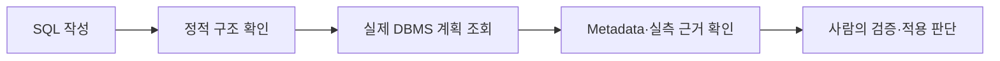
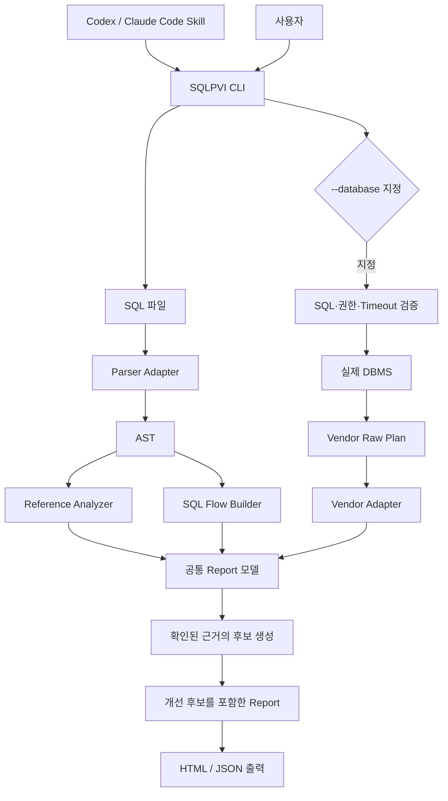
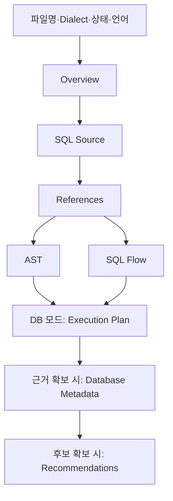
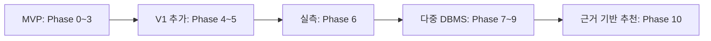

# SQL Plan Visualizer 기획서

> SQL Source → AST → SQL Flow → Database Execution Plan의 관계를 HTML로 시각화하고, 실제 DBMS 근거로 분석 결과를 검증하는 SQL 분석 프로젝트.

기준일: **2026-11-05**. 사용자 제공 기획서의 20개 절을 유지한 현행 정리본.
구현 기준: 현재 코드·CLI·Lock·Compose 설정. 검증 기준: 실제 완료 문서의 실행 시점.

- 작업 계약 원본: [.project/plan.md](.project/plan.md)
- Phase별 구현·Fixture·Gate: [docs/instructions](docs/instructions)
- 실제 구현·검증 기록: `docs/phaseN-*.md`
- 현재 사용법: [README.md](README.md)
- 흐름도·작업 경위·실패 기록: [docs/index.html](docs/index.html)
- 이번 문서 정리의 선택 기록: [한 화면 HTML](docs/planning-decisions-2026-11-05.html)

이 문서 생성에 따른 기존 작업 계약의 우선순위 변경 없음.
`[x]`: 연결된 기록의 구현·검증 확인. `[ ]`: 미구현·미검증·미완료.
과거 검사 통과를 이번 문서 작성의 재실행 결과로 표시하지 않는 기준.

### 원안과 현행 구현의 주요 차이

| 항목 | 현행 기준 |
| --- | --- |
| Python | 사용자 승인된 **3.13.15**. 원안의 3.13.14에서 변경 |
| DBMS 선택 | **`--vendor`**. 원안의 `--dbms`는 현재 CLI 미지원 |
| PostgreSQL Runtime | 명시적 `--database --runtime`으로 지원 |
| MariaDB·SQL Server Runtime | 미구현. 요청 시 오류 처리 |
| Recommendation | PostgreSQL 실측 디스크 정렬·해시 임시 파일 점검 2종 |
| SQL 재작성·Index 추천·LLM 호출 | 미구현 |
| Agent 검증 | Codex의 Skill 절차·CLI 산출물 확인 |
| 원본 계획 | Adapter별 속성 보존. 원본 JSON/XML 전체의 별도 보관은 미구현 |
| 최신 전체 검사 기록 | 2026-11-05, **258 passed, Skip 없음, exit 0** |
| 신규 설치·Git | uv 신규 환경 설치 복구 미완료. Git 저장소·Remote 부재 |

---

## 1. 프로젝트 배경

SQL 작성·수정에 AI 활용 가능. SQL 코드만으로 실제 DBMS의 판단을 확정하는 방식의 한계.
실행 방식에 영향을 주는 요소: Schema·Statistics·자료 분포·Index·권한·DBMS 설정·실행 환경.



핵심 목적: **SQL의 정적 구조와 실제 DBMS 실행 계획의 근거를 연결하고, 사람이 검증할 수 있는 형태로 표현.**

| 직접 다루는 문제 | 대응 |
| --- | --- |
| 불명확한 Table·Column 참조 | 추측 연결 금지, `AMBIGUOUS`·`UNRESOLVED` 유지 |
| SQL만으로 불명확한 실행 방식 | 실제 DBMS의 Estimated Plan 수집 |
| 통계·분포·Index의 영향 | PostgreSQL Catalog와 실행 계획 확인 |
| 실제 실행의 차이 | PostgreSQL의 명시적 Runtime 측정 |
| DB 직접 연결 | SQL Allowlist·권한 제한·Read-only·Timeout·Credential 보호 |

AI의 SQL 작성 능력 평가, 업무 규칙 기반 Schema 설계, ORM N+1 자동 탐지, 데이터 생성 자체의 핵심 범위 제외.

## 2. 프로젝트 개요

SQL 파일을 입력으로 받는 개발자 도구.
Parsing·AST·Reference·SQL Flow 분석과 Standalone HTML·JSON 출력.
사용자 옵션에 따른 실제 DBMS 계획 추가와 근거 기반 점검 후보 표시.

SQL 자동 최적화보다 **정적 분석·DB 관측·추천의 분리와 연결 관계 확인** 우선.

| 구분 | 현재 값 |
| --- | --- |
| 프로젝트명 | SQL Plan Visualizer |
| Repository 예정 이름 | `sql-plan-visualizer` |
| 실제 원격 저장소 | 미설정 |
| 프로젝트 디렉터리 | `sql-plan-visualizer/` |
| Skill 이름·식별자 | SQLPVI / `sqlpvi` |
| Python 배포 패키지 | `sql-plan-visualizer` |
| Python Import Package·CLI | `sqlpvi` |
| 개발 언어·패키지 관리 | Python 3.13.15 / uv |
| 기본 DBMS·결과 형식 | PostgreSQL / Standalone HTML |
| 현재 DBMS 지원 | PostgreSQL·MariaDB·Microsoft SQL Server |
| 개발 도구·연동 형태 | Codex / Codex Skill / 선택적 Claude Code Skill |

GitHub 소개 문구:

> Visualize SQL parsing, ASTs, query flows, and database execution plans.

현재 형태는 CLI·Skill 기반 분석 도구. 일반 DB 질의 비서·MCP 서버·설치형 Plugin 패키지의 구현 없음.

## 3. 핵심 원칙

### 3.1 출처와 Reference 상태의 분리

| 구분 | 값 | 의미 |
| --- | --- | --- |
| 출처 | `STATIC` | SQL Source와 Parser에서 확인한 정보 |
| 출처 | `DATABASE` | 실제 DBMS에서 수집한 정보 |
| 출처 | `RECOMMENDATION` | 확인된 근거에서 도출한 점검 후보 |
| 참조 상태 | `RESOLVED` | 현재 근거로 연결 대상 확정 |
| 참조 상태 | `AMBIGUOUS` | 복수 후보에 따른 대상 미확정 |
| 참조 상태 | `UNRESOLVED` | 대상 확인 근거 부족 |

`RESOLVED`·`DATABASE`의 조합과 별도 상태의 구분.
정적 연결 성공만으로 실제 DB 객체 존재를 보장하는 표현 금지.
DBMS가 반환하지 않은 수치의 임의 생성 금지.

### 3.2 Parsing과 실행 가능성의 분리

Parser 성공 표기: `PARSED`.
`VALID SQL`·`VALID POSTGRESQL QUERY` 등 실제 실행 보증 표현 금지.
DB 계획 수집 성공과 모든 환경에서의 실행 가능성 보장도 구분.

### 3.3 Agent와 분석 엔진의 분리

호출 관계: 사용자 → Codex·Claude Code Skill → SQLPVI CLI → SQLPVI Core.
분석 결과의 기준: Core가 생성한 Report.
Skill의 역할: 파일 경로 확인·CLI 실행·종료 상태 확인·산출물 확인·경로 전달.
실패한 분석 결과의 Agent 임의 보완 금지.

SQL 문자열·주석·식별자에 포함된 지시의 실행 금지.
정적 분석을 위한 DB·LLM Credential 요구 금지.

### 3.4 DBMS Optimizer 재구현 금지

정적 영역: SQL 구조의 AST·References·SQL Flow 생성.
DB 영역: 실제 DBMS 계획의 수집·변환.
SQLPVI의 추정을 DBMS 관측값처럼 표현하는 방식 금지.

### 3.5 자동 변경 금지

| 허용 | 금지 |
| --- | --- |
| SQL 분석·계획 수집 | 입력 SQL 자동 수정·덮어쓰기 |
| 명시적 PostgreSQL Runtime 측정 | 사용자 옵션 없는 실제 Query 실행 |
| 점검 후보·검증 SQL의 텍스트 표시 | 추천 Query 자동 실행 |
| 향후 승인 범위의 Suggested Index 표시 | CREATE/DROP INDEX 자동 실행 |
| 사용자의 적용 판단 | Schema 자동 변경·운영 DB 자동 튜닝 |

출력 경로가 입력과 같은 파일인 경우 거부. Hardlink로 같은 파일을 가리키는 경우도 거부.
분석 성공 뒤 출력 부모 폴더 자동 생성.

## 4. 분석 모델

### 4.1 SQL Flow

공식 명칭: `SQL Flow`. 내부 모델: `SqlFlow`·`SqlFlowNode`.
PostgreSQL 내부 Logical Plan과의 구분.

표현 대상: Scan·Project·Filter·Join·Aggregate·Sort·Distinct·Limit·Offset·CTE·Subquery.
의미: SQL의 구조적 연산 관계. 실제 DBMS의 실행 순서 보장 없음.

### 4.2 Reference

Table·Column·Alias·Scope·후보·Source Range·출처의 보관.
Column 소속의 확정 근거 부족 시 `AMBIGUOUS`·`UNRESOLVED` 유지.
충분한 PostgreSQL Metadata 근거가 있는 참조만 `DATABASE` 출처로 보강.

### 4.3 Source Mapping

실제 SQLGlot Metadata인 `line`·`col`·`start`·`end`의 Fixture 검증.
모든 AST Expression의 완전한 범위 보장 없음.
현재 Parser 제공 범위만 사용. 범위 부재 시 `None` 유지와 가능한 토큰·Reference 연결 사용.
원문 위치를 맞추기 위한 임의 Offset 생성 금지.

### 4.4 현재 Report 계약

| 필드 | 내용 |
| --- | --- |
| `filename`, `sql`, `dialect`, `status` | 입력 경로·원문·Dialect·`PARSED` |
| `ast`, `references`, `flow` | 정적 분석 결과 |
| `warnings`, `basis` | 경고·기본 출처 |
| `plan` | 선택적 `ExecutionPlan` |
| `metadata` | PostgreSQL Catalog 근거 |
| `recommendations` | 근거 기반 점검 후보 |

원안의 독립된 Statement Type 필드는 현재 미구현.
현재 문장 형태의 확인 위치: AST 루트의 `kind`. `status`와 Statement Type의 혼용 금지.

## 5. 최종 아키텍처 계약

정적 분석의 기본 수행. `--database` 지정 시 DB 계획 추가.
PostgreSQL의 `--database --runtime` 지정 시에만 실제 조회 측정.



| 경계 | 입력 → 출력 | 현재 구현 |
| --- | --- | --- |
| CLI | 파일·옵션 → 분석·수집·출력 연결 | `cli.py` |
| Parser Adapter | SQLGlot → 내부 AST | `parser.py` |
| Reference·SQL Flow | AST·Scope → 내부 모델 | `analyze.py` |
| DBMS 선택 | Vendor·환경 변수 → 수집기 | `database.py` |
| DB 안전 경계 | SQL → 허용 Query | `db/safety.py` |
| Vendor Adapter | 실제 JSON/XML → `ExecutionPlan` | `db/postgres.py`·`mariadb.py`·`sqlserver.py` |
| Metadata | PostgreSQL Catalog → 참조 보강 | `metadata.py` |
| Recommendation | 수집된 Report → 후보 목록 | `recommend.py` |
| Renderer | Report → Standalone HTML | `render.py`·`templates`·`assets` |

HTML Renderer 입력: **Report 하나**.
SQLGlot Expression·Vendor JSON/XML의 직접 해석 금지.
실행 계획 표시 경로: `Report.plan`의 내부 모델.
JSON 출력 경로: Report의 직렬화.

Recommendation의 DB·LLM 접속 없음. 이미 수집한 근거의 사용.

## 6. HTML Visualization

### 6.1 화면 구성



| 표시 조건 | 영역 |
| --- | --- |
| 기본 | Overview·SQL Source·References·AST·SQL Flow |
| DB 계획 확보 | Execution Plan |
| PostgreSQL Catalog 확보 | Database Metadata |
| 후보 생성 | Recommendations |

추가 표시: Vendor·`ESTIMATED`/`RUNTIME`·출처·경고.
Runtime 노드의 추정값·실측값 보존. 별도 두 실행 계획의 Diff 화면은 미구현.

### 6.2 Interaction

SQL 토큰 Hover·키보드 Focus와 연결 요소 Highlight.
AST 접기·펼치기, SQL Flow의 SVG 연결선, 근거 링크의 Plan Node 이동.
한/영 전환과 작은 화면 표시.

현재 제외: Drag·Zoom·Mini Map·Animation·Plan Diff·Cost Heatmap·Graph Editor.

### 6.3 HTML 안전성

신뢰할 수 없는 SQL·Identifier·오류 문자열의 데이터 취급.
Escape·안전한 직렬화·Injection 검사 적용.
분석 HTML의 사용자 입력 `innerHTML` 직접 삽입 금지.
외부 CDN·Font·네트워크 없이 핵심 기능 동작.

### 6.4 문서 첫 화면

진입점: [docs/index.html](docs/index.html).
작업 흐름·경위·변경·검증·미완료 항목과 실제 그림 10개 포함.
문서의 기본 그림: Markdown 안의 Mermaid 다이어그램.
표시 조건: Mermaid 지원 Markdown 뷰어. 별도 SVG 파일 보관 없음.
경위 HTML의 흐름도는 HTML/CSS의 상자·분기·화살표로 직접 작성. 별도 그림 파일·Mermaid 실행 도구 요구 없음.
같은 내용 변경 시 Markdown Mermaid와 HTML 흐름도의 관계를 함께 갱신.

## 7. DBMS Plan 모델

변환 관계: Vendor 응답 → Vendor Adapter → `ExecutionPlan`·`PlanNode` → Report.

| 모델 | 실제 필드 |
| --- | --- |
| `ExecutionPlan` | `vendor`, `mode`, `root`, `basis`, `planning_time_ms`, `execution_time_ms` |
| `PlanNode` 공통 | `id`, `operation`, `relation`, `access_method`, `estimated_rows`, `estimated_cost`, `children` |
| Vendor 속성 | `details` |
| 실측 | `actual_rows`, `actual_loops`, `actual_time_ms`, `buffers` |

현재 코드의 snake_case 필드명을 계약으로 사용.
미수집·미제공 값은 `None` 등 원래의 부재 상태 유지.
서로 다른 DBMS의 Cost·Operator·Rows 의미를 문자열 유사성으로 동일시하는 방식 금지.

### 원본 보존의 현재 범위

| Vendor | 현재 변환·보존 범위 |
| --- | --- |
| PostgreSQL | Plan Node 속성의 `details` 보존, 자식 트리 변환, 별도 시간·Buffer 필드 |
| MariaDB | JSON의 dict/list 계층을 노드로 변환, 스칼라 Vendor 속성의 `details` 보존 |
| SQL Server | RelOp 트리·노드 XML Attribute·Object Attribute의 추출·보존 |

**원본 JSON/XML 응답 전체를 Report에 그대로 넣거나 별도 파일로 저장하는 기능은 미구현.**
SQL Server의 모든 XML Element를 보존하는 것으로 과대 표기 금지.
전체 원본 보관이 필요한 경우 별도 범위·보호 기준·검증의 확정 필요.

## 8. 기술 구성과 의존성

현재 Python 기준: **3.13.15**.
사용자 승인에 따른 3.13.14 → 3.13.15 전환 기록은 기존 계약에 보존.

| 구분 | 현재 Lock·설정 | 도입 단계 |
| --- | --- | --- |
| SQL Parser | SQLGlot 30.18.0 | Phase 0~1 |
| Test | pytest 9.1.1 | Phase 0~1 |
| Lint·Format | Ruff 0.16.8 | Phase 0~1 |
| Template | Jinja2 3.1.6 | Phase 2 |
| Visualization | HTML·CSS·Vanilla JS·SVG | Phase 2 |
| PostgreSQL Client | Psycopg 3.3.7·psycopg-binary 3.3.7 | Phase 4 |
| MariaDB Client | PyMySQL 1.2.3 | Phase 8 |
| SQL Server Client | pymssql 2.4.6 | Phase 9 |
| Recommendation | 기존 모델 기반 Python 규칙 | Phase 10·후속 개선 |
| Build Backend | setuptools 84.2.1 | 패키징 |

위 값은 현재 프로젝트의 고정값. 외부 패키지 최신 버전이라는 의미 제외.
직접·전이 의존성의 전체 기준: `uv.lock`의 16개 패키지 항목.

| 격리 DB | `compose.yaml`의 실제 이미지 | 호스트 접속 |
| --- | --- | --- |
| PostgreSQL | `postgres:18.6-alpine` | `127.0.0.1:55432` |
| MariaDB | `mariadb:11.8` | `127.0.0.1:53306` |
| SQL Server | `mcr.microsoft.com/mssql/server:2022-latest` | `127.0.0.1:14330` |

이미지 Tag와 Digest 고정의 구분. SQL Server의 `2022-latest`를 정확한 패치 고정으로 표현하지 않는 기준.
Compose의 SQL Server 서비스명: `mssql`. 준비 작업 서비스명: `sqlserver-init`.

현재 앱 의존성에 없는 항목: FastAPI·React·Node.js·Pydantic·MCP·LLM API·DB Pool·Graph Library.
문서 그림 검증에서 사용한 Mermaid와 앱의 필수 런타임 의존성의 구분.

신규 의존성·버전 변경·Lock 갱신의 사용자 사전 승인.
정식 배포·Python 호환성 확인과 기능에 무관한 업그레이드 분리.

## 9. CLI와 Database 안전성

### 9.1 정적 분석

정상 설치 환경의 기본 명령:

```powershell
uv run sqlpvi analyze fixtures/sql/join.sql --output artifacts/join.html
uv run sqlpvi analyze fixtures/sql/join.sql --format json --output artifacts/join.json
```

DB 접속·Credential·LLM Key 요구 없음.
HTML 기본 경로: 입력 옆의 `.sqlpvi.html`. JSON은 `--output` 생략 시 표준 출력.
분석 성공 후 새 출력 폴더 자동 생성. 입력 덮어쓰기 거부.

기존 설치 환경에서 확인된 Windows sync 오류의 대체 실행:

```powershell
uv --cache-dir .uv-cache run --no-sync sqlpvi analyze fixtures/sql/join.sql --output artifacts/join.html
```

전제: 필요한 잠긴 버전의 부품이 이미 설치된 환경.
`--no-sync` 실행 성공과 새 가상환경 설치 성공의 분리.
현재 uv 신규 설치의 권한·다운로드 문제는 [경위 기록](docs/index.html#install)의 미완료 항목.

### 9.2 DBMS 선택과 예상 계획

```powershell
uv run sqlpvi analyze fixtures/sql/join.sql --database --vendor postgres
uv run sqlpvi analyze fixtures/sql/join.sql --database --vendor mariadb
uv run sqlpvi analyze fixtures/sql/join.sql --database --vendor sqlserver
```

전제: 선택 DBMS의 환경 변수·격리 DB·최소 권한 계정 준비.
DBMS 자동 판별에 Connection String Scheme을 사용하는 방식 없음.
Scheme 검증은 선택한 Adapter의 연결 설정 검증 단계.

| `--vendor` | 기본 Parser Dialect | 계획 수집 |
| --- | --- | --- |
| `postgres` — 기본값 | `postgres` | `EXPLAIN (FORMAT JSON)` |
| `mariadb` | `mysql` | `EXPLAIN FORMAT=JSON` |
| `sqlserver` | `tsql` | `SET SHOWPLAN_XML ON` |

`mysql`은 현재 MariaDB 분석에 사용하는 Parser Dialect 이름. 별도 MySQL 서버 검증 완료 의미 제외.
`--dialect`의 별도 지정은 사용자 요청에 따른 경우에만 적용. DB 모드의 Vendor·Dialect 불일치 거부.

### 9.3 실제 측정

```powershell
uv run sqlpvi analyze fixtures/sql/sort-spill.sql --database --runtime --vendor postgres
```

PostgreSQL의 실제 수집문: `EXPLAIN (ANALYZE, BUFFERS, FORMAT JSON)`.
`--runtime` 단독 지정과 MariaDB·SQL Server Runtime 요청의 오류 처리.
실측 Query 실행 경고와 Report 경고의 표시.

### 9.4 공통 보호 경계

SELECT 계열·함수 Allowlist, 복수 Statement·DML·DDL·SELECT INTO·잠금 지시 차단.
Vendor별 계정 검사·Timeout·Rollback·연결 종료·Credential 비노출.
기본 대상: Local·Development·Test DB. Production 자동 튜닝 사용법 제외.

| Vendor | 현재 보호 방식 |
| --- | --- |
| PostgreSQL | Read-only Transaction, 과권한 Role 거부, Statement 5초·Lock 대기 1초 |
| MariaDB | Read-only Transaction, 세션 Role 해제, 쓰기·권한 위임 검사, Statement 5초·Lock 대기 1초 |
| SQL Server | 쓰기·과권한·권한 위임 검사, Query 5초·Lock 대기 1초, SHOWPLAN OFF 시도·Rollback·Close |

SQL Server의 Read-only 접속 의도는 라우팅 Hint. 단독 쓰기 방지 장치로 간주 금지.
SQL Server 허용 Table Hint: 인자 없는 `NOLOCK`·`READUNCOMMITTED`·`FORCESEEK`·`FORCESCAN`.
금지 Hint 혼합·인자 있는 Hint·알 수 없는 Hint의 거부. Hint 자동 삽입 없음.
`NOLOCK`의 일관성·무잠금 보장으로의 해석 금지.

## 10. 운영 안정성과 지속가능성

| 위험 | 대응·한계 |
| --- | --- |
| Parser 구조·동작 변경 | Parser Adapter·Lock·Fixture 회귀 검사 |
| Parser 성공의 과대 해석 | `PARSED`와 DB 계획 수집의 구분 |
| Column 오연결 | Scope·Alias·Metadata 확인, 미확정 상태 보존 |
| HTML XSS | Escape·직렬화·Injection 검사 |
| UI 복잡도 증가 | 기본 상호작용 유지, Graph Editor 등 미도입 |
| Cost·Runtime 수치 흔들림 | 정확한 숫자보다 구조·출처·의미 검증 |
| DB 부수 효과·지연 | Allowlist·권한·Read-only·명시적 Runtime·Timeout |
| Vendor 의미 손실 | Vendor 이름·속성 보존, 임의 Operator 동치화 금지 |
| Agent의 근거 없는 설명 | Skill의 CLI 실행·실제 출력 확인 계약 |
| 잘못된 추천 | 실제 근거·조건·한계·검증 방법, 근거 부족 시 미생성 |
| Dependency·범위 증가 | 현재 필요성과 사용자 승인, 미래 구현 선반영 금지 |
| 설치 장애의 은폐 | 기존 환경 검사와 신규 설치의 구분·실패 기록 |
| 문서의 완료 과대 표기 | 구현·실제 검증·운영 확인·Git 완료의 분리 |

### 현재 Recommendation의 안전 기준

PostgreSQL·`DATABASE`·`RUNTIME`·확정된 Column 참조의 공통 요구.

| 후보 | 추가 근거 |
| --- | --- |
| 디스크 정렬 점검 | Sort 노드·Disk·양수 공간·Actual Rows·Loops |
| 해시 임시 파일 점검 | Hash 노드·Hash Batches > 1·양수 Temp Written Blocks·Actual Rows·Loops |

Bool·문자열·NaN·Infinity·누락값의 근거 사용 금지.
Seq Scan·높은 Cost·긴 시간만으로 Index 권고 금지.
동일 종류의 여러 Plan Node는 한 후보의 여러 근거로 묶음.
검증 SQL은 원본 조회에 EXPLAIN을 붙인 텍스트. 별도 SQL Rewrite 생성 없음.

## 11. Phase 운영 원칙

목표·Fixture 확정 → 최소 구현 → Unit Test → 실제 실행·출력 확인 →
한계 기록 → Regression Test → Gate 판정 → 완료 문서 반영.

직전 단계의 실제 검증 없이 후속 단계 착수 금지.
미래 기능의 선반영 금지. 시작 시 Phase 0~10 지침의 사전 작성 허용.

Gate 표기의 구분:

- 구현·검사 범위: 해당 코드와 실제 실행 결과의 확인.
- Agent 검증: Codex Skill 절차·CLI 산출물의 확인.
- 전체 원안 완료: 미구현 Runtime·추천 확장·원본 보관 항목까지의 확인.
- Repository 완료: Branch·Commit·승인된 Push·PR·사용자 Merge의 확인.

현재 Phase 완료 문서의 기술 통과 표기를 원안의 모든 장기 기능 완료로 확대하는 방식 금지.

## 12. Phase 구성



MVP 범위: Phase 0~3. V1 범위: Phase 0~5. 확장 단계: Phase 6~10.
각 상태의 상세 근거는 해당 지침·완료 기록. 아래는 현재 구현과 확인 범위.

### Phase 0. Feasibility

목표: SQLGlot·Source Mapping·Standalone HTML·SVG 방식의 가능성 검증.
근거: [지침](docs/instructions/phase0-feasibility.md) / [완료 기록](docs/phase0-feasibility.md).

- [x] 목표 PostgreSQL SQL의 Parsing·AST Traversal·Table/Column/Alias 확인
- [x] Join·Aggregate·Parser Error·위치 Metadata 확인
- [x] 완전한 Expression 범위의 한계와 가능한 Source 연결 확인
- [x] 문자열 안전 출력·최소 HTML·SVG 확인

### Phase 1. Static SQL Analysis

목표: SQL 입력을 Parser 독립 모델로 변환.
근거: [지침](docs/instructions/phase1-static-analysis.md) / [완료 기록](docs/phase1-static-analysis.md).

- [x] SELECT·FROM·WHERE·JOIN·GROUP BY·HAVING·ORDER BY·LIMIT·OFFSET·DISTINCT·집계·Alias 분석
- [x] 서브쿼리·비재귀 CTE Fixture의 구조·참조 확인
- [x] 세 가지 Reference 상태·SQL Flow·오류 처리·실제 CLI 검증
- [ ] 원안의 독립 Statement Type 전용 필드 — 현재 AST 루트 `kind`로 확인

모든 SQL 문법·재귀 CTE 구조의 완전한 분석 지원으로의 확대 표기 금지.

### Phase 2. HTML Visualization

목표: 원문·참조·트리·SQL Flow가 연결된 Standalone HTML.
근거: [지침](docs/instructions/phase2-html-visualization.md) / [완료 기록](docs/phase2-html-visualization.md).

- [x] Overview·SQL Source·References·AST·SQL Flow 표시
- [x] Hover·Focus·안전한 Escape·외부 CDN 없는 동작
- [x] 반복 CLI·Injection·회귀 검증

### Phase 3. SQLPVI Skill

목표: Codex Skill의 CLI 사용 계약. Claude Code 연동은 선택 사항.
근거: [지침](docs/instructions/phase3-sqlpvi-skill.md) / [완료 기록](docs/phase3-sqlpvi-skill.md).

| Agent | 프로젝트 로컬 Skill | 호출 표기 |
| --- | --- | --- |
| Codex | `.agents/skills/sqlpvi/SKILL.md` | `$sqlpvi` |
| Claude Code | `.claude/skills/sqlpvi/SKILL.md` | `/sqlpvi` |

- [x] 두 Skill 파일의 형식·같은 CLI 계약·실패 보고·원문 보존 규칙
- [x] Codex의 Skill 절차에 따른 CLI·HTML·JSON 실제 확인
MVP 완료 기준: Core·CLI 구현과 Codex Skill 절차·산출물의 검증.

### Phase 4. PostgreSQL Estimated Plan

목표: 실제 PostgreSQL Planner의 예상 계획 연결.
근거: [지침](docs/instructions/phase4-postgresql-estimated-plan.md) / [완료 기록](docs/phase4-postgresql-estimated-plan.md).

현재 수집문: `EXPLAIN (FORMAT JSON)`. 원안의 VERBOSE·SETTINGS 옵션은 현재 수집문에 없음.

- [x] `--database` 조건·SELECT/함수 Allowlist·쓰기·잠금 차단
- [x] 제한 계정·Read-only·Statement/Lock Timeout
- [x] JSON 계획 변환·부모/자식·Relation·Index·조건·DB 출처 표시
- [x] Credential 비노출·실제 Integration·Regression 검증
- [ ] 원본 JSON 응답 전체의 별도 보관

### Phase 5. PostgreSQL Plan Enrichment

목표: 필요한 Catalog의 참조 보강과 계획 근거 표시.
근거: [지침](docs/instructions/phase5-postgresql-plan-enrichment.md) / [완료 기록](docs/phase5-postgresql-plan-enrichment.md).

- [x] 대상 Relation의 Schema·Column·Index 정의·Statistics 수집
- [x] 충분한 근거가 있는 Column의 `RESOLVED`·`DATABASE` 보강
- [x] Schema·권한 부족·동명 Column·미분석 통계의 한계 검증
- [x] 실제 계획의 Index 정보와 Catalog Index 정의 표시

현재 별도 Primary Key·Index Column 전용 모델 없음. Index 정의 문자열과 해당 모델의 구분.
V1의 남은 운영 확인: Phase 3의 실제 Agent 호출과 Repository 절차.

### Phase 6. PostgreSQL Runtime Plan

목표: 명시적 실제 조회의 계획·Rows·Loops·Time·Buffers 수집.
근거: [지침](docs/instructions/phase6-postgresql-runtime-plan.md) / [완료 기록](docs/phase6-postgresql-runtime-plan.md).

- [x] `--database --runtime`·실제 실행 경고·Read-only·Timeout
- [x] Actual Rows·Loops·Time·Buffers·전체 실행 시간 수집
- [x] Estimated/Runtime 구분·원문·시험 데이터 보존 검증

Cost와 Actual Time의 단위 직접 비교 금지. 별도 실행 계획 Diff 기능 없음.

### Phase 7. Multi-DBMS Architecture

목표: PostgreSQL 구현을 기준으로 Vendor 경계·능력·연결 설정 분리.
근거: [지침](docs/instructions/phase7-multi-dbms-architecture.md) / [완료 기록](docs/phase7-multi-dbms-architecture.md).

- [x] `--vendor` → Dialect → 환경 변수 → Adapter 선택
- [x] Common/Vendor 속성 분리·미지원 Runtime 거부·Renderer 경계
- [x] `SQLPVI_POSTGRES_URL` 우선·기존 `SQLPVI_DATABASE_URL` 호환
- [x] Adapter·실제 PostgreSQL 회귀 검증

`--dbms` 별칭·Scheme 기반 자동 Vendor 선택의 구현 없음.

### Phase 8. MariaDB

목표: MariaDB Estimated JSON Plan 연결.
근거: [지침](docs/instructions/phase8-mariadb.md) / [완료 기록](docs/phase8-mariadb.md).

- [x] `--vendor mariadb`·PyMySQL·`SQLPVI_MARIADB_URL` 연결
- [x] `EXPLAIN FORMAT=JSON`·Vendor 계층/속성·Read-only·권한·Timeout
- [x] 실제 Integration·다른 Vendor 회귀 검증
- [ ] `ANALYZE FORMAT=JSON` Runtime 수집·Actual 모델·안전장치의 구현

원안의 Runtime 포함 전체 범위는 미완료. 현재 Runtime 요청은 오류 처리.
MariaDB의 ANALYZE는 실제 Query 실행이므로 별도 구현·승인 범위의 검증 필요.

### Phase 9. Microsoft SQL Server

목표: SQL Server Estimated XML Plan 연결.
근거: [지침](docs/instructions/phase9-sqlserver.md) / [완료 기록](docs/phase9-sqlserver.md).

- [x] `--vendor sqlserver`·pymssql·T-SQL·`SQLPVI_SQLSERVER_URL` 연결
- [x] `SHOWPLAN_XML` 수집·Namespace/DTD/Entity 검사·XML 노드 변환
- [x] 실제 Query 미실행·계정 권한·Timeout·SHOWPLAN OFF·Rollback·Close 검증
- [x] 후속 개선의 인자 없는 Table Hint 4종 허용·금지 Hint 차단
- [ ] `STATISTICS XML` Runtime 수집·안전장치
- [ ] 원본 XML 응답 전체 보관

SQL Server Runtime은 현재 미구현. 접속의 Read-only 의도만으로 쓰기 방지 판단 금지.

### Phase 10. Recommendation

목표: 실제 근거에서 도출한 점검 후보와 조건·한계·검증 방법의 제공.
근거: [지침](docs/instructions/phase10-recommendation.md) / [당시 완료 기록](docs/phase10-recommendation.md) / [후속 개선](docs/code-improvements-2026-11-05.md).

- [x] `DATABASE` 근거와 `RECOMMENDATION` 후보의 분리
- [x] 실제 Plan Node로 연결되는 Evidence ID·관측값·조건·한계·검증 방법
- [x] PostgreSQL Runtime의 디스크 정렬·해시 임시 파일 점검 2종
- [x] 근거 부족 시 미생성·추가 DB/LLM 호출 없음·SQL 자동 실행 없음
- [ ] SQL Rewrite 후보 생성·생성 SQL Parser 재검증
- [ ] Index Recommendation
- [ ] Claude/Codex를 통한 후보 생성 연동
- [ ] 재작성 SQL의 의미 동치 미검증 상태 표시

향후 다른 SQL을 생성하는 경우 Parser 재검증 후에도 의미 동치 보장 금지.
원안의 `SEMANTIC EQUIVALENCE NOT VERIFIED`는 향후 표시 요구이며 현재 UI 상태가 아님.

## 13. 테스트 전략

| 층 | 검증 대상 |
| --- | --- |
| Unit | Parser·Reference·SQL Flow·Adapter·Renderer·안전 경계·추천 |
| Fixture | 단순 SELECT·JOIN·집계·Clause·CTE·서브쿼리·위험 문자열 |
| 정적 Integration | SQL → CLI → Report → Standalone HTML/JSON |
| DB Integration | 격리 DB → 실제 계획 → Adapter → Report → 출력 |
| Regression | 기존 Fixture·완료된 단계·모든 구현 Vendor의 영향 |
| Agent Integration | CLI·Skill 산출물과 종료 상태. 자연어 답변의 비교 제외 |

Golden Value 고정 제외: Exact Cost·Exact Estimated Rows·Planning Time·Runtime·Buffer Count.
검증의 중심: 구조·의미·출처·근거 연결·보호 경계·입력/데이터 보존.

### 실제 실행 기록

| 실행 시점 | 범위 | 기록 |
| --- | --- | --- |
| 2026-11-04, Phase 8 | MariaDB 포함 전체 | 127 passed, Skip 없음 |
| 2026-11-04, Phase 9 | SQL Server 포함 전체 | 185 passed, Skip 없음 |
| 2026-11-04, Phase 10 | 디스크 정렬 추천 포함 전체 | 211 passed, Skip 없음 |
| 2026-11-05, 코드 개선 | 출력·Hint·해시 개선, 세 DB 포함 | **258 passed in 18.89s, Skip 없음, exit 0** |

이번 문서 작성만으로 위 전체 검사를 재실행한 것으로 처리하지 않는 기준.
각 수치의 명령·제약: [코드 개선 기록](docs/code-improvements-2026-11-05.md)과 [경위 HTML](docs/index.html#verification).
DB 환경 변수가 없어서 Skip된 실행을 실제 DB 통과로 표시하는 방식 금지.

현재 회귀 실행 예 — 승인된 격리 DB와 테스트 URL 준비 이후:

```powershell
uv --cache-dir .uv-cache --offline lock --check
uv --cache-dir .uv-cache run --no-sync pytest tests -q --basetemp artifacts/pytest-current -p no:cacheprovider --tb=short
uv --cache-dir .uv-cache run --no-sync ruff check .
uv --cache-dir .uv-cache run --no-sync ruff format --check .
```

위 명령의 사용 전제: 기존 설치 환경의 확인된 의존성. 신규 설치 확인의 대체 근거로 사용 금지.

## 14. 환경 변수

| 용도 | 변수 | 현재 선택 기준 |
| --- | --- | --- |
| PostgreSQL | `SQLPVI_POSTGRES_URL` | 현재 우선 변수 |
| PostgreSQL 호환 | `SQLPVI_DATABASE_URL` | 현재 변수의 값 부재 시 사용 |
| MariaDB | `SQLPVI_MARIADB_URL` | MariaDB Adapter에서 사용 |
| SQL Server | `SQLPVI_SQLSERVER_URL` | SQL Server Adapter에서 사용 |
| 격리 통합 검사 | `SQLPVI_TEST_POSTGRES_URL`·`SQLPVI_TEST_MARIADB_URL`·`SQLPVI_TEST_SQLSERVER_URL` | 해당 실제 DB 검사 활성화 |

Phase 0~3의 DB·LLM 환경 변수 요구 없음.
과거 Phase 4~6의 변수는 `SQLPVI_DATABASE_URL`. Phase 7 이후 새 이름과의 호환 유지.
선택 Vendor와 다른 Scheme을 접속 대상으로 자동 전환하는 방식 없음.

`.env`: Git 제외. `.env.example`: 비밀값 없는 네 Key만 보관.
로그·Exception·분석 HTML의 Connection String·Credential 노출 금지.
인증 환경 변수·전역 설정 변경의 별도 승인 경계 유지.

## 15. 프로젝트 구조와 문서 체계

### 현재 주요 구조

```text
sql-plan-visualizer/
├── 기획서.md                 # 현행 기획·구현 상태 정리본
├── .project/plan.md         # 작업 계약 원본
├── AGENTS.md
├── design.md
├── README.md
├── pyproject.toml / uv.lock / .python-version
├── .env.example / .gitignore / compose.yaml
├── .agents/skills/sqlpvi/SKILL.md
├── .claude/skills/sqlpvi/SKILL.md
├── src/sqlpvi/
│   ├── cli.py / parser.py / analyze.py / models.py
│   ├── database.py / metadata.py / recommend.py / render.py
│   ├── db/{safety,postgres,mariadb,sqlserver}.py
│   ├── templates/report.html
│   └── assets/{report.css,report.js}
├── fixtures/{sql,database,plans}/
├── tests/
└── docs/
    ├── index.html
    ├── sqlpvi-decisions-2026-11-05.html
    ├── code-improvements-2026-11-05.md
    ├── instructions/phase0~10-*.md
    ├── phase0~10-*.md
    └── examples/hash-spill.html
```

위 트리는 주요 파일의 묶음 표기. 중괄호·`phase0~10`은 실제 단일 파일명이 아님.
초기 구조와 현재 구현 구조의 구분. 미래 기능을 위한 빈 구현 폴더의 추가 금지.

| 문서 | 역할 |
| --- | --- |
| `.project/plan.md` | 작업 계약과 범위의 원본 |
| `기획서.md` | 사용자 제공 전체 기획의 현행 정리·원안 차이·현재 상태 |
| `docs/instructions/phaseN-*.md` | 단계별 구현·Fixture·Gate |
| `design.md` | 보고서 화면·상호작용·접근성·Escape 기준 |
| `AGENTS.md` | 실행·승인·Git 운영 규칙 |
| `docs/phaseN-*.md` | 당시 실제 구현·명령·결과·한계 |
| `README.md` | 실제 현재 사용법 |
| `docs/index.html` | 흐름·경위·검증·판단·미완료의 열람 화면 |

기존 프로젝트 우선순위 유지:
사용자의 현재 명시적 지시 → `.project/plan.md` → 현재 Phase 지침 → `design.md` → `AGENTS.md` → README.
모든 프로젝트 문서보다 전역 승인·보안 경계 우선.
이 정리본을 이유로 승인 범위·기능 완료 기준을 임의 확대하는 방식 금지.

완료 기록의 필수 내용: 목표·실행 명령·실제 출력·검증 결과·실패 수정·한계.
미실행 명령·예상 수치·미확인 결과의 완료 표기 금지.

문서 웹 진입점: `docs/index.html`. 관련 파일의 docs 내부 상대 경로와 `.nojekyll` 보관.
GitHub Pages의 실제 게시 설정·Git Push·배포는 현재 미수행.

## 16. Git / PR 규칙

Phase 단위: Feature Branch와 Pull Request.
현재 지침의 브랜치 패턴: `feat/phaseN-*`. 실제 Branch 생성 여부와 이름 계획의 구분.

| 작업 | 담당·조건 |
| --- | --- |
| 구현·검사·문서·로컬 Commit | Codex, 사용자 승인 범위의 작업 |
| Push·PR 생성 | 사용자 사전 승인 범위에서 Codex |
| PR 검토·Merge·main 전환·Pull | 사용자 |
| Codex의 Merge·main 갱신 | 사용자 명시적 요청 필요 |

기존 승인 범위의 유지와 불필요한 재승인 요청 금지.
일반 Push 승인을 강제 Push·히스토리 재작성 승인으로 확대하는 방식 금지.

기술 완료: 구현·해당 검사·한계 기록·README 반영.
Repository 완료: 기술 완료 + Branch/Commit + 승인된 Push/PR + 사용자 검토·Merge.

현재 상태: `.git`·Remote 부재. Branch·Commit·Push·PR·Merge 완료 표기 없음.
저장소 초기화·원격 생성·웹 게시를 기획서 작성에 포함하는 방식 없음.

PR 필수 내용: 문제와 변경 동작, 변경 파일, 실제 검증 명령·결과, 남은 한계.
실패·미검증 작업을 완료 Commit·PR 결과로 기록하는 방식 금지.

## 17. 범위 구분

| 구분 | 범위 | 현재 상태의 해석 |
| --- | --- | --- |
| MVP | Phase 0~3 | Core·CLI·HTML·Skill 파일 구현. Agent 운영 확인 일부 미완료 |
| V1 | Phase 0~5 | PostgreSQL 예상 계획·필요 Catalog 구현. MVP의 운영 미검증 상태 승계 |
| V1 이후 | Phase 6~10 | PostgreSQL 실측·Vendor 분리·MariaDB/SQL Server 예상 계획·점검 후보 구현 |
| 후속 확장 | 미구현 원안 항목 | 별도 필요성·범위·검증·승인의 확정 필요 |

후속 확장 후보: MariaDB Runtime·SQL Server Runtime·전체 Raw Plan 보관·SQL Rewrite·Index Recommendation·Agent 후보 생성.
계획에 있는 기능과 구현 완료 기능의 분리.

범위 밖: 사용자 명시 없는 Query 실행, 추천 SQL 자동 적용, 입력 덮어쓰기,
Index·Schema 자동 변경, Production 자동 튜닝, DB Migration, DB Monitoring Platform,
범용 DB 관리, ORM N+1 자동 탐지, 업무 규칙 기반 Schema 설계.

MCP 서버·개인정보 자동 가림·SSH 연결도 현재 미구현. 관련 글의 소개만으로 도입 승인 간주 금지.

## 18. 최종 완료 기준

### 18.1 V1 구현·검증 범위

- [x] `.sql` 파일·PostgreSQL Dialect·AST·Table/Column/Alias·SQL Flow
- [x] Join/Filter/Aggregate·서브쿼리·비재귀 CTE Fixture 분석
- [x] 세 가지 참조 상태·가능한 Source 연결·안전한 Standalone HTML
- [x] PostgreSQL Estimated Plan·트리·Index 정보·필요 Catalog
- [x] Static/Database 출처·Credential 비노출·입력 보존의 검사
- [x] Codex의 Skill 절차와 실제 CLI 산출물 확인
- [x] Phase별 실행 기록·README·회귀 기록
- [ ] 독립 Statement Type 필드의 원안 차이 해소 여부 판단

### 18.2 현재 확장 구현·검증 범위

- [x] PostgreSQL 명시적 Runtime·Estimated/Actual 필드 구분
- [x] DBMS Adapter·`--vendor`·환경 변수 호환·미지원 요청 처리
- [x] MariaDB Estimated JSON·SQL Server Estimated XML·실제 세 DB 통합 검사
- [x] 정렬·해시 점검 후보 2종과 Evidence·조건·한계·검증 절차
- [x] 자동 SQL·Index·Schema 변경 없음의 검사
- [x] 2026-11-05 전체 258 passed·Skip 없음의 실행 기록

### 18.3 장기 원안의 남은 항목

- [ ] MariaDB Runtime Plan
- [ ] SQL Server Runtime Plan
- [ ] 원본 JSON/XML 전체 보관
- [ ] Query Rewrite Recommendation
- [ ] Index Recommendation
- [ ] 생성 SQL의 Parser 재검증과 의미 동치 미검증 표기
- [ ] Claude/Codex 후보 생성의 Evidence 연결 검증

### 18.4 환경·Repository의 남은 항목

- [ ] uv 신규 환경의 전체 설치 성공·CLI 실행 확인
- [ ] Git 저장소·Remote 확보와 실제 Branch·Commit
- [ ] 사용자 승인 범위의 Push·PR
- [ ] 사용자 검토·Merge
- [ ] 문서 사이트의 실제 게시가 필요한 경우 별도 게시 확인

위 항목을 묶어 “원안 전체 완료”로 표시하는 방식 금지.
후속 기능 필요성의 사용자 판단과 현행 코드 검사의 구분.

## 19. 최종 프로젝트 정의

1. 근거가 있는 구조 분석.
2. 사람이 이해할 수 있는 시각화.
3. 실제 DBMS 계획과의 연결.
4. 입력·권한·실행·출력의 안정성 검증.
5. Vendor의 고유 의미를 보존한 지원 확대.
6. 조건과 한계를 가진 점검 후보의 제시.
7. 실제 변경의 사용자 판단.

핵심 기준: **추측보다 실제 근거 확인. 정적 사실·DB 관측·SQLPVI 해석의 분리.**
기능 수보다 분석 정확성·재현 가능한 검사·미확인 상태의 정직한 표기 우선.

## 20. 공식 근거

외부 기능 설명의 참고 자료. 현재 구현 완료 여부의 기준은 프로젝트 코드와 실제 실행 기록.

| 대상 | 공식 자료 |
| --- | --- |
| SQLGlot | [공식 문서](https://sqlglot.com/) |
| PostgreSQL 계획·Runtime | [EXPLAIN](https://www.postgresql.org/docs/18/sql-explain.html), [Using EXPLAIN](https://www.postgresql.org/docs/18/using-explain.html) |
| PostgreSQL 접속·Timeout | [Client Connection Defaults](https://www.postgresql.org/docs/18/runtime-config-client.html) |
| MariaDB 예상 계획 | [EXPLAIN FORMAT=JSON](https://mariadb.com/docs/server/reference/sql-statements/administrative-sql-statements/analyze-and-explain-statements/explain-format-json) |
| MariaDB 실제 실행 — 후속 범위 | [ANALYZE FORMAT=JSON](https://mariadb.com/docs/server/reference/sql-statements/administrative-sql-statements/analyze-and-explain-statements/analyze-format-json) |
| SQL Server 예상 계획 | [SET SHOWPLAN_XML](https://learn.microsoft.com/en-us/sql/t-sql/statements/set-showplan-xml-transact-sql) |
| SQL Server 실제 실행 — 후속 범위 | [Actual Execution Plan](https://learn.microsoft.com/en-us/sql/relational-databases/performance/display-an-actual-execution-plan) |
| Claude Code Skill | [공식 Skills 문서](https://code.claude.com/docs/en/skills) |
| Codex Skill | [공식 Build skills 문서](https://developers.openai.com/codex/build-skills) |
| 문서 게시 | [GitHub Pages 게시 경로](https://docs.github.com/en/pages/getting-started-with-github-pages/configuring-a-publishing-source-for-your-github-pages-site) |

프로젝트의 구체적 증거:
[현재 CLI](src/sqlpvi/cli.py) · [모델](src/sqlpvi/models.py) · [Vendor 선택](src/sqlpvi/database.py) ·
[추천 규칙](src/sqlpvi/recommend.py) · [의존성](pyproject.toml) · [격리 DB](compose.yaml) ·
[실행·실패·판단 기록](docs/index.html).
